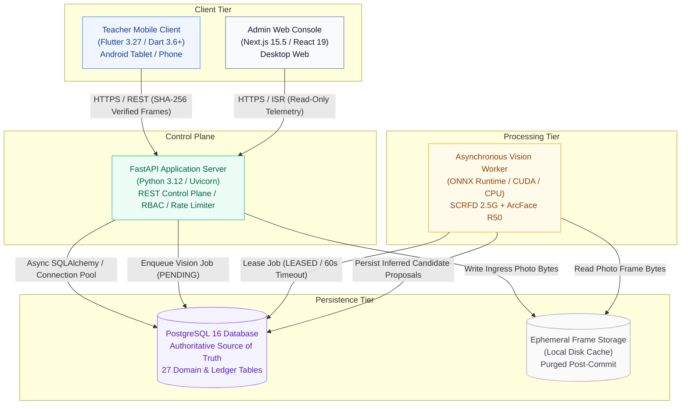
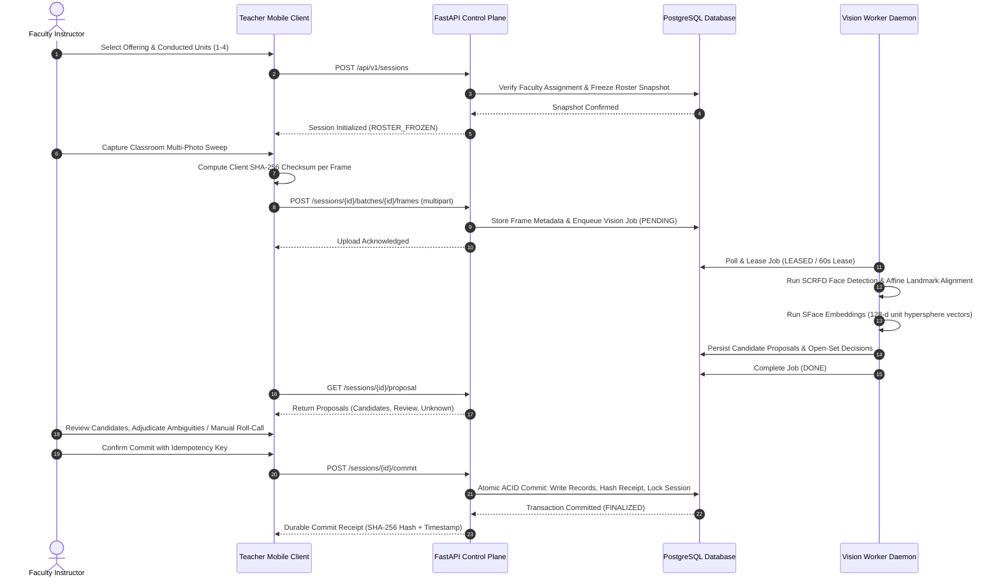
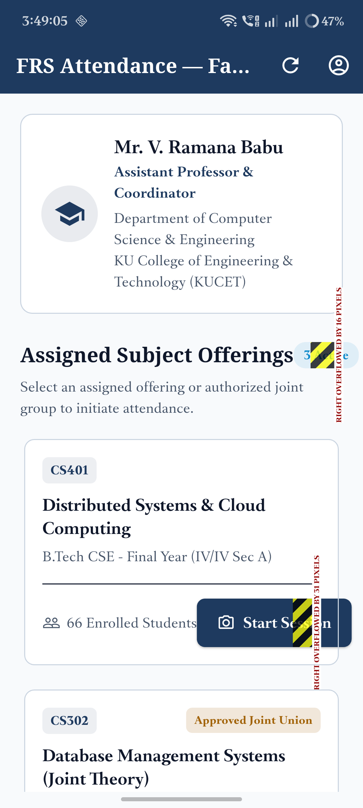
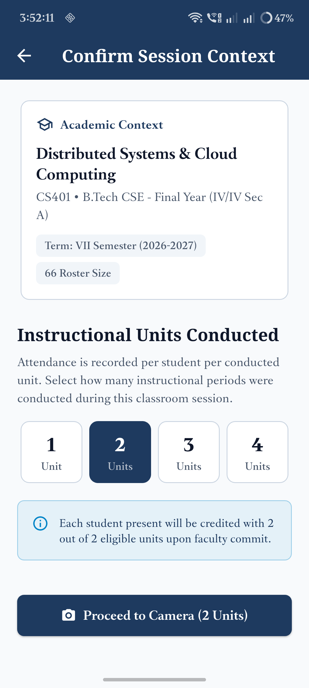
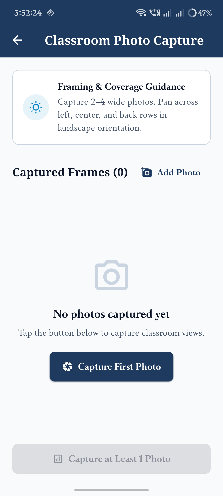
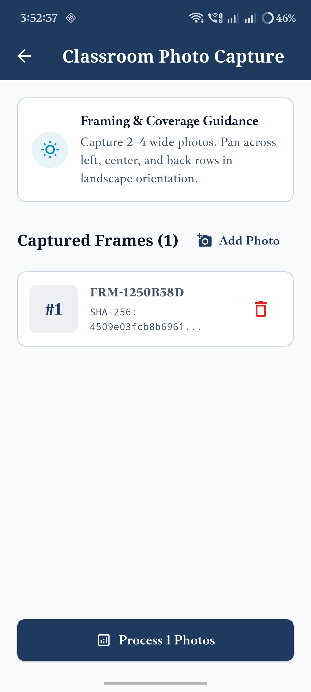
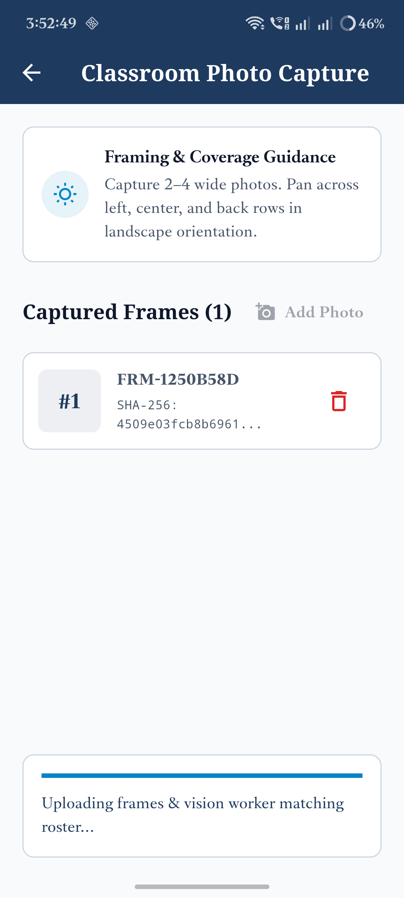
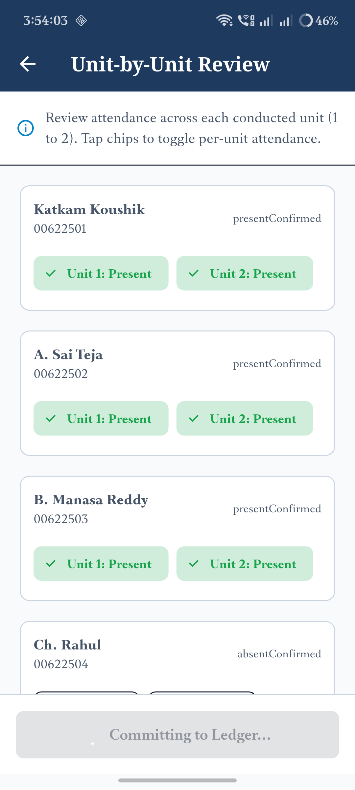

# FRS V7.1 K² — Classroom Attendance Proposal System

[](.github/workflows/ci.yml)
[](.github/workflows/deploy.yml)
[](.github/workflows/security.yml)
[](https://github.com/KatkamKoushik/K-Squared-Face-Recognition-Attendance-System/wiki)
[](docs/CONTRACT_ARCHITECTURE.md)
[](docs/adr/)
[](backend/)
[](apps/teacher_mobile/)
[](apps/admin_console/)
[](backend/)
[](docker-compose.yml)
[](LICENSE)

**FRS V7.1 K²** is an institutional classroom-photo attendance proposal system engineered for **Kakatiya University College of Engineering & Technology (KUCET)**. 

The platform replaces single-face biometric punch kiosks and paper attendance ledgers with an asynchronous, multi-face classroom sweep workflow. Under this architecture, the computer vision subsystem operates strictly as an **evidence producer**, not an authoritative decision maker. A faculty member captures multi-photo sweep bursts, reviews model-generated candidate proposals against an immutable roster snapshot, resolves lookalike or unassigned sightings, and executes an atomic ledger commit anchored by cryptographic verification.

---

## Official GitHub Technical Wiki

The complete institutional technical manual and architecture guide is hosted directly on the **[Official GitHub Wiki](https://github.com/KatkamKoushik/K-Squared-Face-Recognition-Attendance-System/wiki)**:

| Wiki Manual | Description | Live Link | Local Mirror |
| :--- | :--- | :---: | :---: |
| **Wiki Home & Overview** | Core philosophy, proposal workflow, invariant guarantees, and index. | [Open on Wiki](https://github.com/KatkamKoushik/K-Squared-Face-Recognition-Attendance-System/wiki) | [Home.md](wiki/Home.md) |
| **System Architecture** | Multi-tier microservices, Docker network isolation, container topologies. | [Open on Wiki](https://github.com/KatkamKoushik/K-Squared-Face-Recognition-Attendance-System/wiki/System-Architecture) | [System-Architecture.md](wiki/System-Architecture.md) |
| **Data Model & State Machines** | 27 relational tables, session lifecycle state machines, ER diagrams. | [Open on Wiki](https://github.com/KatkamKoushik/K-Squared-Face-Recognition-Attendance-System/wiki/Data-Model-and-State-Machine) | [Data-Model-and-State-Machine.md](wiki/Data-Model-and-State-Machine.md) |
| **Computer Vision Pipeline** | SCRFD face detection, ArcFace ResNet-50 embeddings, open-set $\tau=0.60$. | [Open on Wiki](https://github.com/KatkamKoushik/K-Squared-Face-Recognition-Attendance-System/wiki/Computer-Vision-Pipeline) | [Computer-Vision-Pipeline.md](wiki/Computer-Vision-Pipeline.md) |
| **REST API Reference** | OpenAPI 3.1 endpoint catalog, standard response envelopes, DTOs. | [Open on Wiki](https://github.com/KatkamKoushik/K-Squared-Face-Recognition-Attendance-System/wiki/API-Reference) | [API-Reference.md](wiki/API-Reference.md) |
| **Security, Privacy & Governance** | Ephemeral frame wiping, client SHA-256 anchoring, zero raw facial storage. | [Open on Wiki](https://github.com/KatkamKoushik/K-Squared-Face-Recognition-Attendance-System/wiki/Security-Privacy-and-Governance) | [Security-Privacy-and-Governance.md](wiki/Security-Privacy-and-Governance.md) |
| **Operations & Deployment** | Docker Compose configurations, Alembic migrations, disaster recovery. | [Open on Wiki](https://github.com/KatkamKoushik/K-Squared-Face-Recognition-Attendance-System/wiki/Operations-and-Deployment) | [Operations-and-Deployment.md](wiki/Operations-and-Deployment.md) |
| **Roadmap & Project Status** | Quality gate verification matrix, test coverage, institutional milestones. | [Open on Wiki](https://github.com/KatkamKoushik/K-Squared-Face-Recognition-Attendance-System/wiki/Roadmap-and-Project-Status) | [Roadmap-and-Project-Status.md](wiki/Roadmap-and-Project-Status.md) |

---

## Technical Documentation & Engineering Specifications

Comprehensive system documentation, runbooks, and specifications:

* **[Official GitHub Technical Wiki](https://github.com/KatkamKoushik/K-Squared-Face-Recognition-Attendance-System/wiki)**: Full 8-article architecture and domain guide hosted live on GitHub with persistent navigation sidebar.
* **[Production Operations Runbook](docs/OPERATIONS_RUNBOOK.md)**: Disaster recovery, RPO/RTO targets, database restore drills, model rotation gates, and incident severity SLA matrix.
* **[Production Engineering Readiness Audit](docs/PRODUCTION_READINESS_AUDIT.md)**: 62-section lifecycle evaluation against enterprise engineering standards.
* **[Master Engineering Inventory Checklist](docs/MASTER_ENGINEERING_CHECKLIST.md)**: Consolidated engineering inventory with P0/P1/P2 priorities and verification evidence.
* **[CI/CD Workflow Testing Audit](docs/CI_WORKFLOW_TESTING_AUDIT.md)**: Multi-tier automation audit covering merge queues, security sweeps, and deployment pipelines.
* **[Definition of Done (DoD)](docs/DEFINITION_OF_DONE.md)**: Strict acceptance gates for mathematical invariants, security, tests, and code signing.
* **[Architecture Decision Records (ADRs)](docs/adr/)**: Formal ADRs documenting denominator arithmetic, roster freezing, ONNX pipelines, human review, and idempotency receipts.

---

## System Architecture



---

## End-to-End Operational Workflow



---

## Core Domain & Mathematical Invariants

### 1. Per-Conducted-Unit Denominator Rule
Attendance percentage is strictly computed as the ratio of attended units to eligible conducted units:

```math
\text{Attendance Rate (\%)} = 100 \times \frac{\sum_{u \in U_c} \mathbb{I}(\text{status}(s, u) = \text{PRESENT})}{|U_c|}
```

where $U_c$ represents the set of verified conducted units ($1 \le |U_c| \le 4$). 

> **Denominator Guardrail:** If an evaluation period or student record has zero eligible conducted units ($|U_c| = 0$), the attendance rate strictly evaluates to **`N/A`**. The system never coerces unconducted units to 0% or 100%, preventing statistical distortion in official university accreditation reports.

### 2. Immutable Roster Snapshot
When a session transitions from `DRAFT` to `ROSTER_FROZEN`, the control plane takes an immutable snapshot of all enrolled students actively registered in the subject offering or merged class group. Mid-session roster mutations, student dropouts, or cohort adjustments do not alter the session's frozen denominator.

### 3. Open-Set Rejection Boundary
Classroom photographs contain non-enrolled individuals (e.g. guest auditors, lab technicians). Sightings are classified according to cosine similarity $s = \mathbf{v}_q \cdot \mathbf{v}_r$ against enrolled reference embeddings:

```math
\text{Decision}(\mathbf{v}_q) = \begin{cases}
\text{CANDIDATE (Proposed Present)} & \text{if } s \ge 0.60 \quad \text{and} \quad \Delta s \ge 0.15 \\
\text{REVIEW (Lookalike Ambiguity)} & \text{if } 0.45 \le s < 0.60 \quad \text{or} \quad \Delta s < 0.15 \\
\text{UNKNOWN (Unassigned Sighting)} & \text{if } s < 0.45
\end{cases}
```

### 4. Zero Automatic Absence on Uncertainty
The system never automatically marks a student absent because of a computer vision failure. Low resolution, occlusion, blur, or network interruptions surface as explicit triage states (`INSUFFICIENT_EVIDENCE`, `REVIEW`, `RECAPTURE_REQUIRED`). Faculty can immediately toggle to the **Manual Attendance Roll-Call Screen** to credit present students directly.

---

## Repository Map

```text
frs-v7-1-k2/
├── .github/
│   ├── CODEOWNERS                     # Subsystem code review boundaries
│   ├── dependabot.yml                 # Automated weekly dependency updates (pip, npm, pub, actions)
│   └── workflows/
│       ├── ci.yml                     # Multi-tier CI testing (Flutter 3.27, Node 22, Python 3.12, contracts)
│       ├── deploy.yml                 # CD: Publish GHCR Docker images, build APK, rollout host
│       └── security.yml               # Automated weekly security & supply chain audit
│
├── apps/
│   ├── admin_console/                 # Next.js 15.5 / React 19 institutional admin portal
│   │   ├── app/
│   │   │   ├── academic/              # Academic structure, course offerings, joint-class groups
│   │   │   ├── audit/logs/            # Immutable audit trail browser (biometrics redacted)
│   │   │   ├── reports/attendance/    # Authoritative attendance analytics per conducted unit
│   │   │   ├── roster-preview/        # Live roster freeze & DPDP consent inspector
│   │   │   ├── students/              # Student registry & enrolment management
│   │   │   ├── system/readiness/      # Hardware telemetry and database pool monitor
│   │   │   ├── error.tsx              # WCAG 2.2 AA client error boundary with retry action
│   │   │   ├── not-found.tsx          # Institutional 404 resource recovery page
│   │   │   ├── layout.tsx             # Root layout with accessible skip-to-content anchor
│   │   │   └── page.tsx               # Executive overview dashboard
│   │   ├── components/                # Institutional navigation, sidebar, and layout primitives
│   │   ├── lib/
│   │   │   ├── api.ts                 # Typed API client with envelope unwrapping and 10s ISR
│   │   │   └── session.ts             # Cross-tab session manager and storage purge
│   │   ├── app/                       # Next.js 15.5 App Router pages & server components
│   │   │   ├── analytics/             # Department & offering attendance analytics
│   │   │   ├── audit/                 # Institutional audit log browser & hash chain
│   │   │   ├── classes/               # Authorized class groups and enrolled student rosters
│   │   │   ├── faculty/               # Faculty directory and teaching assignments
│   │   │   ├── governance/            # Biometric privacy consent, ephemeral purge & HMAC receipt verification
│   │   │   ├── sessions/              # Active & finalized classroom session monitoring
│   │   │   ├── students/              # Student directory and DPDP consent tracking
│   │   │   └── system/readiness/      # Real-time infrastructure readiness & ONNX model registry
│   │   ├── public/robots.txt          # Crawler exclusion policy protecting student privacy
│   │   ├── Dockerfile                 # Multi-stage production container build (standalone output)
│   │   └── package.json               # Node.js dependencies
│   │
│   └── teacher_mobile/                # Flutter 3.27 / Dart 3.6+ Android faculty application
│       ├── android/app/               # Native Android host & release signing configuration
│       ├── lib/
│       │   ├── core/
│       │   │   ├── network/           # API client & durable offline sync journal (500-entry queue with reactive UI)
│       │   │   ├── permissions/       # Camera permission manager & manual roll-call fallback
│       │   │   └── theme/             # Material 3 Swiss Modernism design system & status badges
│       │   ├── data/                  # Canonical Dart DTOs, wire serialization, offline mocks
│       │   ├── logic/                 # Riverpod 2.6 session workflow state notifier
│       │   ├── presentation/
│       │   │   └── screens/           # Home, Setup, Gallery, Review, Manual Roll-Call, Receipt
│       │   └── main.dart              # Application entrypoint
│       └── pubspec.yaml               # Flutter package manifest
│
├── backend/                           # Python 3.12 FastAPI control plane & vision worker
│   ├── alembic/                       # PostgreSQL database migration scripts
│   │   ├── versions/                  # Revision 3a42e90c6daf (27 tables baseline)
│   │   ├── env.py                     # Async SQLAlchemy engine migration runner
│   │   └── script.py.mako             # Migration template generator
│   ├── app/
│   │   ├── api/v1/                    # REST routers (academic, sessions, capture, review, ledger, governance, health)
│   │   ├── core/                      # Configuration, rate limiter, security headers, privacy log redaction, async DB pool
│   │   ├── domain/                    # SQLAlchemy ORM models and canonical state enums (27 tables)
│   │   ├── schemas/                   # Pydantic V2 request, response, governance, and envelope contracts
│   │   ├── seeds/                     # Authentic KUCET institutional seeder & approved model registry
│   │   ├── services/                  # Business logic (session, roster, ACID commit, governance, review, analytics)
│   │   └── worker/                    # ONNX background worker (leasing queue, YuNet detector, SFace recognizer, PAD)
│   ├── tests/                         # Pytest automated test suite (84 unit/security/persistence/eval + 11 Playwright E2E)
│   ├── verify_backend.py              # 5-suite mathematical invariant & acceptance test runner
│   ├── alembic.ini                    # Alembic environment and driver configuration
│   ├── Dockerfile                     # Multi-stage production API image
│   ├── Dockerfile.worker              # Multi-stage production vision worker image
│   └── pyproject.toml                 # Python dependencies & build metadata
│
├── docs/                              # Formal architectural documentation & operational runbooks
│   ├── adr/                           # Architecture Decision Records (ADR 0001 – 0005)
│   ├── CI_WORKFLOW_TESTING_AUDIT.md   # Exhaustive GitHub Actions CI/CD workflow testing audit
│   ├── CONTRACT_ARCHITECTURE.md       # Canonical cross-language DTO contract specifications
│   ├── DEFINITION_OF_DONE.md          # Formal engineering quality gate & acceptance checklist
│   ├── MASTER_ENGINEERING_CHECKLIST.md# Complete 55-section software engineering master checklist
│   ├── OPERATIONS_RUNBOOK.md          # Disaster recovery, restore drills, SLAs, incident runbooks
│   └── PRODUCTION_READINESS_AUDIT.md  # 62-section production engineering readiness audit
│
├── packages/
│   └── contracts/                     # Single source-of-truth cross-language contracts
│       ├── lib/                       # Canonical Dart domain contracts
│       ├── src/                       # Canonical TypeScript domain contracts
│       ├── openapi.json               # Canonical OpenAPI 3.1 schema specification
│       └── package.json               # NPM package manifest (@frs/contracts)
│
├── wiki/                              # Comprehensive GitHub technical documentation wiki
├── docker-compose.yml                 # Local multi-service orchestration (Postgres, API, Worker, Web)
├── docker-compose.prod.yml            # Hardened production multi-container orchestration with migration gating
├── Makefile                           # Unified developer automation commands (test, verify, lint, up)
├── run.ps1                            # Windows PowerShell developer automation runner
├── .gitignore                         # Comprehensive monorepo ignore rules
└── LICENSE                            # Apache License, Version 2.0
```

---

## Core API Specification

| HTTP Method | Endpoint Route | Authorization | Description |
| :--- | :--- | :--- | :--- |
| `GET` | `/api/v1/health/liveness` | Public | Process liveness probe confirming server is active. |
| `GET` | `/api/v1/health/readiness` | Public | Validates database pool saturation, Redis queue, and approved model registry. |
| `GET` | `/api/v1/health/metrics` | Public | Prometheus exposition format metrics (uptime, status, invariants). |
| `GET` | `/api/v1/academic/departments` | Authenticated | Lists all academic departments. |
| `GET` | `/api/v1/academic/cohorts` | Authenticated | Lists graduation cohorts and enrolment units. |
| `GET` | `/api/v1/academic/terms` | Authenticated | Lists operational semester terms. |
| `GET` | `/api/v1/academic/offerings` | Authenticated | Lists active subject offerings for the current term. |
| `GET` | `/api/v1/academic/groups` | Authenticated | Lists authorized joint-class groups and member cohorts. |
| `GET` | `/api/v1/academic/faculty-assignments` | Authenticated | Lists authorized faculty teaching assignments. |
| `GET` | `/api/v1/academic/students` | Authenticated | Retrieves student registry with enrollment and consent statuses. |
| `POST` | `/api/v1/sessions` | `FACULTY` | Initializes session, verifies assignment, freezes roster snapshot. |
| `GET` | `/api/v1/sessions/{id}/roster` | `FACULTY` | Returns the frozen roster snapshot of eligible students. |
| `POST` | `/api/v1/sessions/{id}/batches/{id}/frames` | `FACULTY` | Ingests classroom photo frame with SHA-256 checksum. |
| `GET` | `/api/v1/sessions/{id}/proposal` | `FACULTY` | Returns inferred evidence candidates for instructor review with non-biometric routing. |
| `POST` | `/api/v1/sessions/{id}/commit` | `FACULTY` | Executes atomic ACID commit with HMAC-SHA256 signed cryptographic receipt. |
| `POST` | `/api/v1/sessions/{id}/receipt/verify` | Authenticated | Cryptographically verifies HMAC-SHA256 receipt signature and ledger record integrity. |
| `POST` | `/api/v1/ledger/corrections` | `FACULTY` / `ADMIN` | Corrects post-commit records or student appeals with mandatory audit justification. |
| `GET` | `/api/v1/governance/status` | `ADMIN` | Institutional telemetry: consent compliance %, frame counts, and storage footprint. |
| `POST` | `/api/v1/governance/purge` | `ADMIN` | Ephemeral frame purge: unlinks raw images older than retention days with audit log. |
| `POST` | `/api/v1/governance/consent` | `ADMIN` | Toggles student biometric consent status under the DPDP Act framework. |
| `GET` | `/api/v1/offerings/{id}/analytics` | Authenticated | Computes official attendance analytics per conducted unit. |
| `GET` | `/api/v1/audit/events` | `ADMIN` | Institutional audit log browser (biometrics redacted). |

---

## Security, Privacy & Biometric Governance

1. **On-Premise Institutional Sovereignty:** Zero data is transmitted to external cloud APIs. All computation executes locally on Kakatiya University hardware.
2. **Irreversible Vector Embeddings:** The neural network outputs 128-dimensional floating-point vectors on unit hypersphere $\mathbb{S}^{127}$. Original facial images cannot be mathematically reconstructed from these embeddings.
3. **Digital Personal Data Protection (DPDP) Act Compliance:** Biometric template enrollment requires verified student DPDP consent. Students without consent are routed to alternative manual roll-call workflows with zero penalty.
4. **Ephemeral Storage Purge Engine:** Raw classroom sweep frames are stored ephemerally on local disk and physically unlinked via automated background tasks or administrative governance controls post-retention window (default 7 days).
5. **Cryptographic Receipt Verification:** Attendance commitments emit an authoritative HMAC-SHA256 receipt signed with server secret key. The control plane provides tamper-evident receipt verification against the immutable attendance ledger.
6. **Ingress Protection & Payload Guardrails:** Responses enforce `X-Content-Type-Options: nosniff`, `X-Frame-Options: DENY`, `Referrer-Policy`, and production HSTS. Inbound requests enforce 15MB bounded `Content-Length` (`413 Payload Too Large`), prohibited MIME type filtering (`415 Unsupported Media Type`), and sliding-window rate limiting.
7. **PostgreSQL Persistence Foundation & Pooling:** 27 normalized relational tables managed via Alembic baseline revision `3a42e90c6daf`. Fail-closed production URL validation prevents insecure defaults; credentials are masked in logs and health endpoints; connection pooling enforces `pool_pre_ping=True` and `pool_recycle=1800` to prevent connection leaks and stale sockets.
8. **Offline Sync Resilience & Session Security:** Teacher mobile app buffers up to 500 actions in a durable, faculty-scoped `OfflineSyncJournal` with reactive UI banners, jittered exponential backoff, and logout purge. Admin Console syncs auth across tabs and completely clears browser session and local storage on logout.
9. **Log Privacy Redaction:** `SafePrivacyFormatter` filters Bearer tokens, passwords, secrets, embedding vector coordinates, and base64 image strings from application and container logs.
10. **Biometric Redaction:** Facial crops, landmark coordinates, and raw embedding arrays are strictly excluded from administrative dashboards, application logs, and audit tables.

---

## Verified Mobile UI & Operational Workflow Gallery

The teacher mobile client runs on Flutter 3.27 / Dart 3.6+ and guides faculty through the complete classroom proposal lifecycle:

| Step 1: Faculty Home & Assigned Offerings | Step 2: Session Setup & Unit Allocation | Step 3: Camera Multi-Photo Sweep |
| :---: | :---: | :---: |
|  |  |  |
| *View assigned course offerings, cached offline journal count, and faculty profile.* | *Select conducted units (1–4), freeze student eligibility snapshot, and create session.* | *Capture classroom photo sweep bursts with real-time frame guidance and SHA-256 checks.* |

| Step 4: Capture Burst Gallery | Step 5: Proposal Review & Lookalike Adjudication | Step 6: ACID Commit & Cryptographic Receipt |
| :---: | :---: | :---: |
|  |  |  |
| *Inspect thumbnail sweeps, verify frame quality, and trigger vision inference worker.* | *Review candidate detections, adjudicate ambiguities, and route withheld consent to manual roll-call.* | *Submit atomic idempotency commit and obtain authoritative HMAC-SHA256 signed receipt.* |

---

## Environment Variables Reference

All runtime services are configured via environment variables. Copy `.env.example` to `.env` before starting services:

| Variable | Tier | Type | Default Value | Required in Production | Description & Security Invariant |
| :--- | :--- | :--- | :--- | :---: | :--- |
| `DATABASE_URL` | Backend | string | `sqlite+aiosqlite:///./frs_dev.db` | Yes | PostgreSQL async connection URL (`postgresql+asyncpg://...`). SQLite fail-closed in production. |
| `SECRET_KEY` | Backend | string | `dev_insecure_secret_key...` | Yes | Cryptographic HMAC-SHA256 signing secret for session receipts and JWT tokens. Must be $\ge 32$ bytes. |
| `ALLOWED_HOSTS` | Backend | list | `["localhost", "127.0.0.1", "kucet.ac.in"]` | Yes | Trusted Host Header origins. Wildcard `"*"` is strictly forbidden in production. |
| `ENVIRONMENT` | Backend | enum | `development` | Yes | Runtime mode (`development`, `staging`, `production`). Enforces SSL and PostgreSQL in production. |
| `PORT` | Backend | integer | `8000` | No | FastAPI HTTP listener port. |
| `STORAGE_DIR` | Backend | string | `/data/frames` | No | Shared local filesystem path for ephemeral classroom capture photos. |
| `LOG_LEVEL` | Backend | enum | `INFO` | No | Application logging verbosity (`DEBUG`, `INFO`, `WARNING`, `ERROR`). |
| `LOG_FORMAT` | Backend | enum | `json` | No | Log output format (`text` for local development, `json` for production). |
| `REDACT_SENSITIVE_LOGS` | Backend | boolean | `true` | Yes | Redacts JWT tokens, passwords, embedding coordinates, and base64 payloads from logs. |
| `MAX_UPLOAD_SIZE_MB` | Backend | integer | `15` | No | Bounded HTTP request payload guardrail rejecting bodies $> 15\text{MB}$ (`413 Payload Too Large`). |
| `CORS_ORIGINS` | Backend | list | `["http://localhost:3000"]` | Yes | Allowed CORS origin URLs for the Next.js Admin Console. |
| `NEXT_PUBLIC_API_URL` | Web | string | `http://localhost:8000/api/v1` | Yes | Base URL for FastAPI REST control plane accessed by the browser. |
| `API_URL` | Mobile | string | `http://10.0.2.2:8000/api/v1` | Yes | Compile-time base URL for Flutter mobile client connecting to control plane. |

---

## Getting Started & Local Development

### Prerequisites

| Tool | Version Requirement | Purpose |
| :--- | :--- | :--- |
| **Python** | $\ge 3.12.0$ | Control plane API & vision worker |
| **Flutter SDK** | $\ge 3.27.0$ (Dart $\ge 3.6.0$) | Teacher mobile application |
| **Node.js** | $\ge 22.0.0$ (with npm $\ge 10.0.0$) | Admin web console |
| **Docker** | $\ge 24.0.0$ (with Compose V2) | Local multi-service orchestration |

### 1. Unified Monorepo Developer Commands

For Windows (PowerShell):
```powershell
# Run all tests across backend, mobile, admin, and contracts
.\run.ps1 test

# Execute mathematical invariant & acceptance verification suite
.\run.ps1 verify

# Run static analysis and linting
.\run.ps1 lint

# Launch local Docker Compose stack
.\run.ps1 up
```

For Linux / macOS / Git Bash:
```bash
make test        # Run all test suites
make verify      # Run backend invariant acceptance suite
make lint        # Run linters and analyzers
make up          # Start Docker Compose services
```

### 2. Manual Service Commands

```bash
# Backend Unit, Security, Persistence, Governance & Pilot Simulation Tests (86 passed)
cd backend && python -m pytest tests/ -v -m "not playwright"

# Playwright Browser E2E Automation (15 passed across all Admin Console routes including /login and /pilot)
cd backend && python -m pytest tests/test_playwright_admin_console.py -v

# Backend Invariant Acceptance Suite (5/5 suites passed with 100% invariant fidelity)
cd backend && python verify_backend.py

# Admin Console Unit Tests (4 passed with native node:test runner)
cd apps/admin_console && npm test

# Admin Console Typecheck & Production Build (0 errors, 14 prerendered routes)
cd apps/admin_console && npm run typecheck && npm run build

# Flutter Teacher Mobile Code Analysis (0 issues found)
dart analyze apps/teacher_mobile

# Shared Contracts Parity Check (0 errors across TS and Dart)
dart analyze packages/contracts/lib/domain_contracts.dart
npm --prefix packages/contracts run typecheck
```

---

## Verification & Test Matrix

All test suites must pass before pull requests can merge into `main`:

| Tier | Directory | Test Command | Outcome |
| :--- | :--- | :--- | :--- |
| **Control Plane Unit, Security, Governance & Pilot Simulation** | `backend` | `python -m pytest tests/ -v -m "not playwright"` | **86/86 Passed** (+ 1 resilient PG environment skip) |
| **Playwright Browser E2E** | `backend` | `python -m pytest tests/test_playwright_admin_console.py -v` | **15/15 Passed** (100% of Admin Console routes including `/login` and `/pilot` verified) |
| **Acceptance Invariants** | `backend` | `python verify_backend.py` | **5/5 Suites Passed** (100% mathematical invariant fidelity) |
| **Admin Console Unit Suite** | `apps/admin_console` | `npm test` | **4/4 Passed** (Node native runner; mock integrity & token injection) |
| **Admin Console Build** | `apps/admin_console` | `npm run build` | **0 errors** (14 static/ISR routes prerendered) |
| **Mobile Analysis** | `apps/teacher_mobile` | `dart analyze` | **0 issues found** (Clean static analysis) |
| **Shared Contracts** | `packages/contracts` | `dart analyze` & `npm run typecheck` | **0 issues found** (Full cross-language parity) |

---

## License & Institutional Attribution

Licensed under the [Apache License, Version 2.0](LICENSE).

Copyright 2026 Kakatiya University College of Engineering & Technology (KUCET). All rights reserved.
