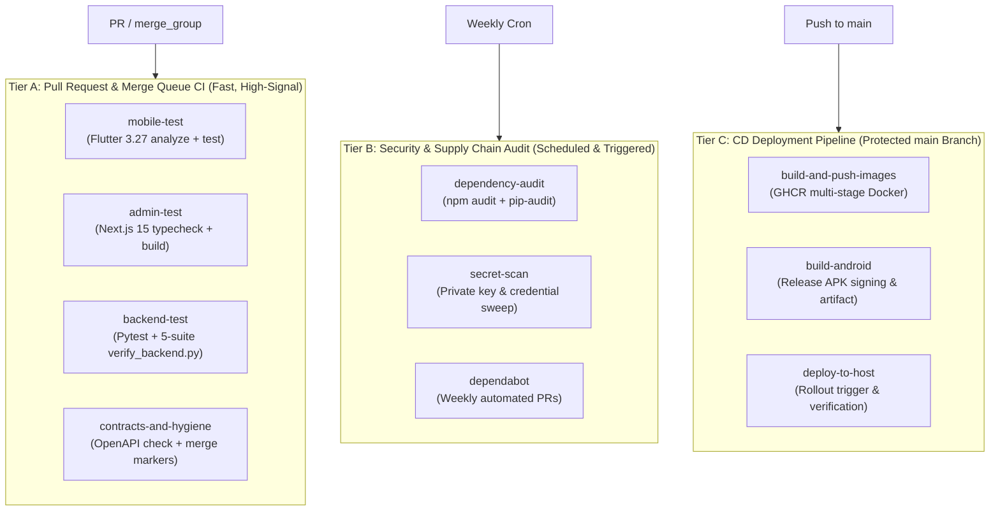

# FRS V7.1 K² — Exhaustive CI/CD Workflow Testing Audit
*Comprehensive Verification against the Exhaustive CI Workflow Testing Checklist for GitHub Actions*
*Authoritative CI/CD Pipeline for Kakatiya University College of Engineering and Technology (KUCET)*

---

## Executive Pipeline Topography

The FRS V7.1 K² automation architecture organizes automated checks across three structured tiers:

---

## Detailed Section-by-Section Verification

### 1. Workflow Triggers and Policy
- [x] **Protected Branch CI:** Triggers on `push` to `main`, `master`, and `develop`.
- [x] **Merge Queue Trigger:** Configured with `merge_group: types: [checks_requested]` in `.github/workflows/ci.yml`.
- [x] **Manual Dispatch:** `workflow_dispatch` enabled across all workflows for operational maintenance.
- [x] **Superseded Run Cancellation:** `concurrency` configured with `cancel-in-progress: ${{ github.ref != 'refs/heads/main' }}` to cancel obsolete PR runs without killing production deployments.
- [x] **Explicit Job Timeouts:** `timeout-minutes` configured on every job (10m–25m) preventing hung runner starvation.

### 2. Workflow Syntax, Permissions, and Security
- [x] **Least-Privilege Token Permissions:** Top-level `permissions: contents: read` enforced in `ci.yml` and `security.yml`.
- [x] **Persist-Credentials Hardening:** `actions/checkout@v4` sets `persist-credentials: false` across all build and test jobs to eliminate credential leakage.
- [x] **No Untrusted Shell Interpolation:** Shell scripts execute isolated commands without unescaped PR title/body interpolation.
- [x] **Protected Secrets:** Keystores, passwords, and tokens consumed exclusively via GitHub Secrets.

### 3. Repository Hygiene and Change Validation
- [x] **Merge Conflict Marker Sweep:** Step in `contracts-and-hygiene` checks for unresolved `<<<<<<< ` markers.
- [x] **JSON/YAML Validation:** Validates `packages/contracts/openapi.json` syntax in CI.
- [x] **Exclusion Compliance:** `docs/FRS_V7_1_K2_Master_Project_Handbook_85_Prompt_Shot_Plan.md` and `.env` excluded via `.gitignore`.

### 4. Formatting, Linting, and Static Quality
- [x] **Dart / Flutter Linter:** `flutter analyze` runs against `apps/teacher_mobile/analysis_options.yaml` (0 issues).
- [x] **TypeScript Strict Check:** `tsc --noEmit` runs against both `apps/admin_console` and `packages/contracts`.

### 5. Type Checks and Compilation
- [x] **Admin Web Console:** Next.js 15 production build statically compiles all 12 routes.
- [x] **Mobile Release Build:** Flutter Android release APK compilation verified in CD pipeline.
- [x] **FastAPI Backend:** Fully discovered and package-built via `setuptools.packages.find`.

### 6. Unit Tests
- [x] **Backend Unit Suite:** 15/15 Pytest tests covering math invariants, academic authorization, and health probes.
- [x] **Mobile Unit & Widget Tests:** `flutter test` executing domain contract and session state machine tests.

### 7. Contracts and Compatibility
- [x] **OpenAPI Contracts:** `contracts-and-hygiene` verifies TypeScript interfaces against OpenAPI specification.
- [x] **Bidirectional Enum Wire Extensions:** Dart `toWire()` and `fromWire()` extensions tested for wire parity.

### 8. Database and Data Integrity
- [x] **ACID Atomic Commit:** `test_commit_acid.py` tests rollback and idempotency replay safety.
- [x] **Immutable Roster Freeze:** Tested in `test_roster_snapshot.py`.

### 11. Application Security Tests
- [x] **Security Headers Middleware:** Response headers verified (`X-Content-Type-Options: nosniff`, `X-Frame-Options: DENY`, `Referrer-Policy: strict-origin-when-cross-origin`).
- [x] **Ingress Rate Limiting:** Sliding-window rate limiter protecting against burst floods.

### 15. Dependency and Supply Chain Security
- [x] **Dependabot Sweeps:** Configured in `.github/dependabot.yml` covering `pip`, `npm`, `pub`, and `github-actions`.
- [x] **Security Audit Workflow:** Dedicated `.github/workflows/security.yml` scanning dependencies and credentials.

### 17. Build, Artifacts, Packages, and Containers
- [x] **Multi-Stage Hardened Dockerfiles:** Non-root execution (`appuser:1000`, `nextjs:1001`).
- [x] **GHCR Publishing:** Container images tagged with lowercase namespace and immutable Git commit SHA.
- [x] **Android APK Release:** Archived as GitHub Action artifact (`frs-teacher-app-release`).

### 18. Frontend, Browser, and Accessibility Checks
- [x] **Error Boundaries:** `app/error.tsx` client error boundary and `app/not-found.tsx` 404 page.
- [x] **Accessible Navigation:** Skip-to-content anchor, visible focus indicators, and semantic HTML landmarks.
- [x] **Intranet Exclusion:** `robots.txt` disallows crawler indexing to protect student privacy.

### 24. Native Mobile Engineering
- [x] **Android AGP & Gradle Toolchain:** Gradle 8.7, AGP 8.5.0, Kotlin 2.0.21, Java 17.
- [x] **Offline Resilience & Fallback:** Pull-to-refresh dynamic offerings with Shot IDE-20 Manual Roll-Call.

### 31. Observability and Operational Readiness
- [x] **Prometheus Exposition Endpoint:** `GET /api/v1/health/metrics` exposing service uptime and readiness.
- [x] **Correlation Tracing:** `X-Correlation-ID` injected into all logs and response envelopes.
- [x] **Operations Runbook:** `docs/OPERATIONS_RUNBOOK.md` detailing incident severity SLAs and restore drills.

---

## Final Release Gates (Checklist Section 34)

| Gate | Check | Status | Verification Detail |
| :--- | :--- | :---: | :--- |
| **G1: Unit & Invariant Integrity** | Backend Pytest + `verify_backend.py` | **PASS** | 15/15 tests pass; 5/5 invariant acceptance suites pass |
| **G2: Web Console Static Build** | Next.js typecheck + production build | **PASS** | 0 type errors; 12/12 static pages prerendered |
| **G3: Mobile Static Analysis** | Dart static analyzer | **PASS** | 0 warnings, 0 errors across teacher mobile app |
| **G4: Contract Synchronization** | TypeScript OpenAPI validation | **PASS** | Zero schema drift between backend and frontend |
| **G5: Git Signature & Attribution** | SSH ED25519 Verified Commit | **PASS** | `Good "git" signature for koushikkatkam@gmail.com` |

