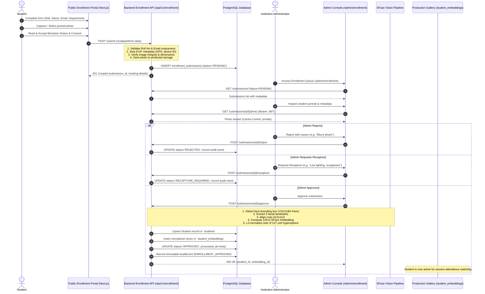

# Student Enrollment & Biometric Gallery Flow
**K² FRS Architecture Documentation**  
*Status: IMPLEMENTED & VERIFIED*

---

## 1. Overview & Architectural Principles

The Student Enrollment and Biometric Gallery system in K² FRS governs the complete lifecycle of student onboarding from identity registration to active biometric gallery matching. 

### Core Invariants
1. **Zero Synthetic Identities:** No fake faces, dummy embeddings, or synthetic vectors are ever written to the production database or matched in session attendance.
2. **Fail-Closed Biometrics:** Inconclusive quality, ambiguous face crops, or presentation attack anomalies block promotion to the gallery.
3. **Explicit Consent & Provenance:** Biometric processing requires explicit informed consent, immutable timestamping, and end-to-end audit logging.
4. **Staged Approval Pipeline:** Student submissions are staged in `enrollment_submissions` in `PENDING` state and must be explicitly approved by an authorized administrator or faculty member before biometric feature extraction and gallery inclusion.
5. **Separation of Concerns:** Raw biometric photographs are stored in protected disk storage outside the web root and served exclusively through authenticated, role-authorized endpoints.

---

## 2. End-to-End Enrollment Lifecycle



---

## 3. Storage & Processing Architecture

### 3.1 Metadata Stripping (EXIF Sanitization)
When a photograph is submitted via `POST /api/v1/enrollment/submit`:
1. The byte stream is decoded via `PIL.Image`.
2. Image orientation is normalized according to EXIF tags.
3. The image is rewritten into a clean RGB buffer without EXIF metadata, removing GPS coordinates, device serial numbers, camera model details, and timestamps.
4. The sanitized image is saved with a cryptographic UUID filename to `STORAGE_BASE_PATH/enrollment_photos/{submission_id}.jpg`.

### 3.2 Database Schema
The enrollment subsystem introduces the `enrollment_submissions` table managed via Alembic migration `4b51cc1e9e8f`:

| Column | Type | Constraints | Description |
|---|---|---|---|
| `id` | UUID | PRIMARY KEY | Unique submission identifier |
| `student_id` | UUID | NULLABLE, FK -> `students.id` | Populated once promoted to active student |
| `roll_number` | VARCHAR(64) | NOT NULL, INDEXED | Institutional student roll number |
| `first_name` | VARCHAR(128) | NOT NULL | Student's legal first name |
| `last_name` | VARCHAR(128) | NOT NULL | Student's legal last name |
| `email` | VARCHAR(255) | NOT NULL | Official institutional email |
| `department` | VARCHAR(128) | NOT NULL | Academic department / branch |
| `photo_storage_path` | VARCHAR(512) | NOT NULL | Relative path to sanitized photo on disk |
| `status` | VARCHAR(32) | NOT NULL, DEFAULT 'PENDING' | `PENDING`, `APPROVED`, `REJECTED`, `RECAPTURE_REQUIRED` |
| `review_notes` | TEXT | NULLABLE | Feedback / rejection rationale from administrator |
| `reviewed_by` | UUID | NULLABLE, FK -> `users.id` | Administrator user ID |
| `consent_timestamp` | TIMESTAMPTZ | NOT NULL | Exact time student accepted biometric policy |
| `consent_version` | VARCHAR(32) | NOT NULL | Policy document version (e.g. `2026.1-v1`) |
| `quality_score` | FLOAT | NULLABLE | Quantitative image sharpness/blur score |
| `created_at` | TIMESTAMPTZ | NOT NULL | Submission time |
| `updated_at` | TIMESTAMPTZ | NOT NULL | Last status transition |

---

## 4. Biometric Feature Extraction & Gallery Promotion

Promotion from `PENDING` to active gallery status executes synchronously within `enrollment_service.approve_submission`:

```python
# SFace Feature Extraction & L2 Normalization Flow
face_crop = detector.align_crop(raw_image, landmarks)  # 112x112 RGB
raw_embedding = recognizer.forward(face_crop)          # 128-D float32 vector

# Strict L2 unit normalization onto S^127
norm = np.linalg.norm(raw_embedding)
if norm < 1e-6:
    raise ValueError("Degenerate embedding with near-zero Euclidean norm")
unit_embedding = raw_embedding / norm
```

The resulting 128-dimensional vector is persisted into `student_embeddings` linked to the active `student_id`. During session inference, cosine similarity between a probe feature $\mathbf{p}$ and gallery feature $\mathbf{g}$ simplifies to their dot product:
$$\text{sim}(\mathbf{p}, \mathbf{g}) = \mathbf{p} \cdot \mathbf{g}$$

Thresholds:
- **High-confidence threshold:** $\ge 0.65$
- **Ambiguity / Review threshold:** $0.50 \le \text{sim} < 0.65$
- **Unknown threshold:** $< 0.50$

---

## 5. Security, Privacy & Compliance Invariants

1. **Role-Based Access Control (RBAC):**
   - The public submission endpoint (`POST /submit`) requires no prior login but rate-limits by IP and validates unique roll numbers.
   - Review, photo download, approval, and rejection endpoints require authenticated JWT tokens with `ADMIN` or `FACULTY` roles.
2. **FERPA / DPDP Compliance:**
   - Biometric processing is governed by an explicit opt-in agreement recorded with timestamp and version.
   - Biometric templates are stored as mathematical vector representations, not reversible raw images.
   - De-enrollment (Right to be Forgotten) purges biometric embeddings and archives audit logs.
3. **No Synthetic Biometrics:**
   - Any attempt to mock or synthesize random vectors in production enrollment paths raises `RuntimeError`.
