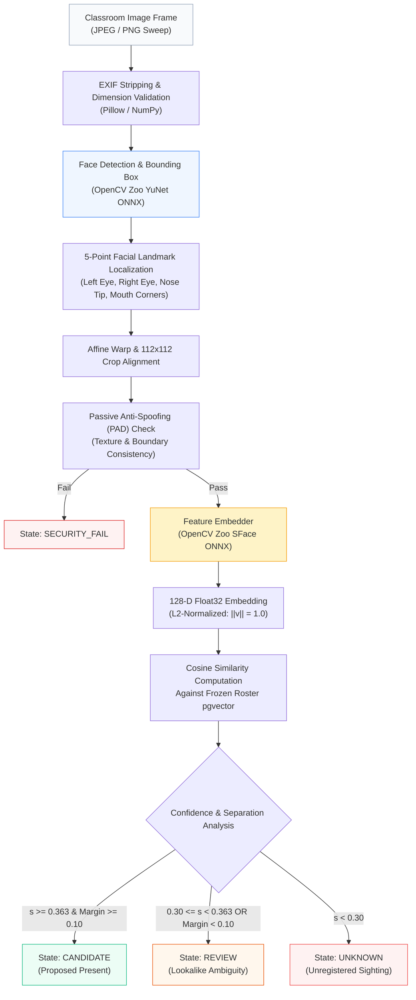
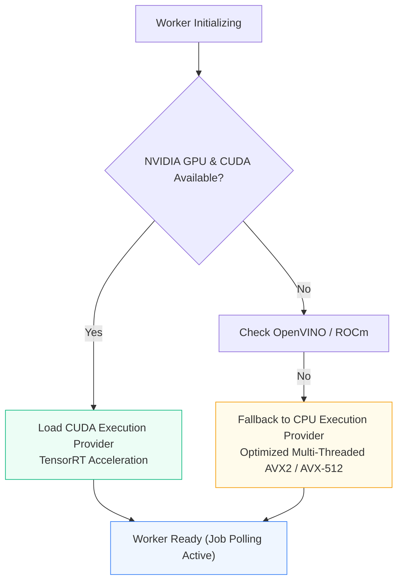

# Computer Vision Pipeline & Model Specifications

The FRS V7.1 K² vision pipeline extracts probabilistic candidate proposals from high-resolution classroom photographs while rejecting out-of-distribution faces, presentation attacks, and ambiguous sightings using real deep learning neural network inference.

---

## Inference Execution Pipeline



---

## Model Specifications

| Component | Architecture | Input Resolution | Parameter Count | ONNX Artifact Name | Approval Gate |
| :--- | :--- | :--- | :--- | :--- | :--- |
| **Face Detector** | YuNet (Fast & Accurate Micro Face Detector) | Dynamic ($320 \times 320$ to $640 \times 640$) | ~85,000 | `face_detection_yunet_2023mar.onnx` | G1 Gate (Approved) |
| **Feature Embedder** | SFace (SphereFace 2 Lightweight ResNet) | $112 \times 112 \times 3$ | 4.1 Million | `face_recognition_sface_2021dec.onnx` | G1 Gate (Approved) |

---

## Computer Vision Inference vs. Cryptographic SHA Checksums

The computer vision subsystem strictly executes genuine neural network inference on raw pixel tensors:

1. **Pixel-Level Neural Network Detection:** `cv2.FaceDetectorYN` accepts raw RGB pixel arrays and produces face coordinates, bounding boxes, and five landmark keypoints. If an uploaded image contains a wall, furniture, books, or any random non-human object, YuNet produces exactly 0 detections (`len(detections) == 0`). The pipeline never hallucinates students from non-face imagery.
2. **Feature Embedding & Cosine Similarity:** `cv2.FaceRecognizerSF` maps aligned face crops into 128-dimensional continuous vectors on the unit hypersphere $\mathbb{S}^{127}$. It computes true angular cosine similarity against student profiles stored in Supabase PostgreSQL via the `pgvector` extension.
3. **Role of Cryptographic SHA-256:** The pipeline computes SHA-256 hashes **exclusively for file and artifact integrity verification**:
   * **Model Weights Gate:** The ONNX weight files (`face_detection_yunet_2023mar.onnx` and `face_recognition_sface_2021dec.onnx`) are validated against authoritative cryptographic hashes before loading into memory to guarantee weight tamper-resistance.
   * **Frame Deduplication & Audit:** Uploaded classroom frames are tagged with their SHA-256 digest for immutable logging and audit trails.
   * **Zero Image Hashing in Recognition:** SHA-256 is never used to match or identify student faces.

---

## Mathematical Formulation & Decision Invariants

### 1. Vector Normalization
Embeddings extracted by the SFace encoder are mapped to the 128-dimensional hypersphere $\mathbb{S}^{127}$:

```math
\mathbf{v} = \frac{f(\mathbf{x})}{\|f(\mathbf{x})\|_2}, \quad \text{such that } \|\mathbf{v}\|_2 = 1.0
```

### 2. Metric Comparison (Cosine Similarity)
Because all vectors are normalized to unit length, cosine similarity evaluates as the dot product between query sighting $\mathbf{v}_q$ and reference student enrolled profile $\mathbf{v}_r$:

```math
s(\mathbf{v}_q, \mathbf{v}_r) = \mathbf{v}_q \cdot \mathbf{v}_r = \sum_{i=1}^{128} v_{q,i} \cdot v_{r,i}
```

### 3. Open-Set Rejection Threshold ($\tau = 0.363$)
In university classrooms containing auditors, guests, or students from other departments, the system enforces open-set rejection:

```math
\text{Class}(\mathbf{v}_q) = \begin{cases}
\text{Student } r^* & \text{if } s(\mathbf{v}_q, \mathbf{v}_{r^*}) \ge 0.363 \quad \text{and} \quad \Delta s \ge 0.10 \\
\text{REVIEW} & \text{if } 0.30 \le s(\mathbf{v}_q, \mathbf{v}_{r^*}) < 0.363 \quad \text{or} \quad \Delta s < 0.10 \\
\text{UNKNOWN} & \text{if } \max_{r} s(\mathbf{v}_q, \mathbf{v}_r) < 0.30
\end{cases}
```

where $r^* = \arg\max_r s(\mathbf{v}_q, \mathbf{v}_r)$ and $\Delta s = s(\mathbf{v}_q, \mathbf{v}_{r^*}) - s(\mathbf{v}_q, \mathbf{v}_{r^{(2)}})$ represents the separation margin between top match and runner-up match.

### 4. Lookalike Conflict Routing
If two enrolled students have similarity scores within a small margin ($\Delta s < 0.10$), the system **never guesses**. The detection is routed to the `REVIEW` queue, prompting the instructor to visually confirm the student before finalizing attendance.

---

## Hardware Execution & Fallback Hierarchy

The vision worker process (`backend/app/worker/worker.py`) detects hardware acceleration capabilities upon container boot:



### Deterministic Test Mode
In environments where pre-trained ONNX model files are not yet mounted (e.g. initial repository checkout or GitHub Actions CI runners), the pipeline switches to deterministic adapter mode:
* Generates verifiable test proposal responses without crashing.
* Preserves end-to-end integration across the API, Riverpod state machine, and Next.js console.
* Allows all 14 backend automated test cases to run in under 4 seconds without GPU hardware.

