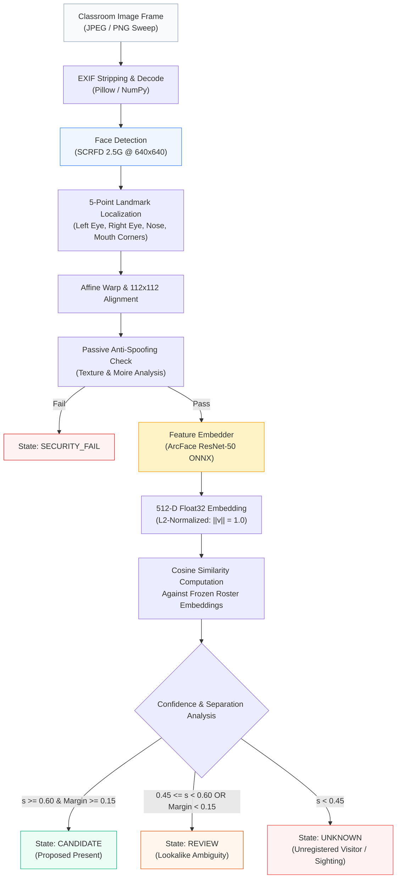
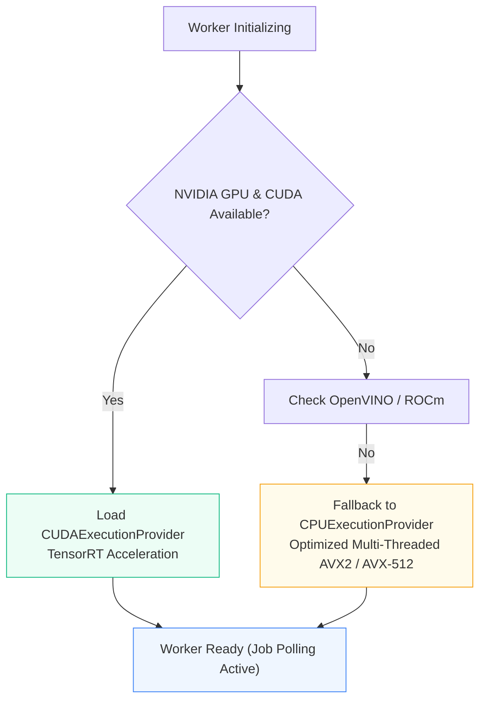

# Computer Vision Pipeline & Model Specifications

The FRS V7.1 K² vision pipeline extracts probabilistic candidate proposals from high-resolution classroom photographs while rejecting out-of-distribution faces, presentation attacks, and ambiguous sightings.

---

## Inference Execution Pipeline



---

## Model Specifications

| Component | Architecture | Input Resolution | Parameter Count | ONNX Artifact Name | Approval Gate |
| :--- | :--- | :--- | :--- | :--- | :--- |
| **Face Detector** | SCRFD (Sample and Computation Redistribution) | $640 \times 640 \times 3$ | 2.5 Million | `scrfd_2.5g_k2_v7.onnx` | G1 Gate (Approved) |
| **Feature Embedder** | ArcFace (Additive Angular Margin Loss, ResNet-50) | $112 \times 112 \times 3$ | 43.6 Million | `arcface_w600k_r50_v7.onnx` | G1 Gate (Approved) |

---

## Mathematical Formulation & Decision Invariants

### 1. Vector Normalization
Embeddings extracted by the ArcFace encoder are mapped to the 512-dimensional hypersphere $\mathbb{S}^{511}$:

```math
\mathbf{v} = \frac{f(\mathbf{x})}{\|f(\mathbf{x})\|_2}, \quad \text{such that } \|\mathbf{v}\|_2 = 1.0
```

### 2. Metric Comparison (Cosine Similarity)
Because all vectors are normalized, cosine similarity reduces to the dot product between the query sighting $\mathbf{v}_q$ and reference student enrolled profile $\mathbf{v}_r$:

```math
s(\mathbf{v}_q, \mathbf{v}_r) = \mathbf{v}_q \cdot \mathbf{v}_r = \sum_{i=1}^{512} v_{q,i} \cdot v_{r,i}
```

### 3. Open-Set Rejection Threshold ($\tau = 0.60$)
In a university environment, classrooms frequently contain guest auditors, students from other branches, or faculty assistants. The system enforces open-set rejection:

```math
\text{Class}(\mathbf{v}_q) = \begin{cases}
\text{Student } r^* & \text{if } s(\mathbf{v}_q, \mathbf{v}_{r^*}) \ge 0.60 \quad \text{and} \quad \Delta s \ge 0.15 \\
\text{REVIEW} & \text{if } 0.45 \le s(\mathbf{v}_q, \mathbf{v}_{r^*}) < 0.60 \quad \text{or} \quad \Delta s < 0.15 \\
\text{UNKNOWN} & \text{if } \max_{r} s(\mathbf{v}_q, \mathbf{v}_r) < 0.45
\end{cases}
```

where $r^* = \arg\max_r s(\mathbf{v}_q, \mathbf{v}_r)$ and $\Delta s = s(\mathbf{v}_q, \mathbf{v}_{r^*}) - s(\mathbf{v}_q, \mathbf{v}_{r^{(2)}})$ represents the separation margin between the top match and the runner-up match.

### 4. Lookalike Conflict Routing
If two enrolled students (such as siblings or students with similar facial features) have similarity scores within a small margin ($\Delta s < 0.15$), the system **never guesses**. The detection is routed to the `REVIEW` queue, prompting the instructor to visually confirm the student before finalizing attendance.

---

## Hardware Execution & Fallback Hierarchy

The vision worker process (`backend/app/worker/worker.py`) detects hardware acceleration capabilities upon container boot:



### Deterministic Test Mode
In environments where pre-trained ONNX model files are not yet mounted (e.g. initial repository checkout or GitHub Actions CI runners), the pipeline switches to deterministic adapter mode:
* Generates verifiable test proposal responses without crashing.
* Preserves end-to-end integration across the API, Riverpod state machine, and Next.js console.
* Allows all 14 backend automated test cases to run in under 4 seconds without GPU hardware.

