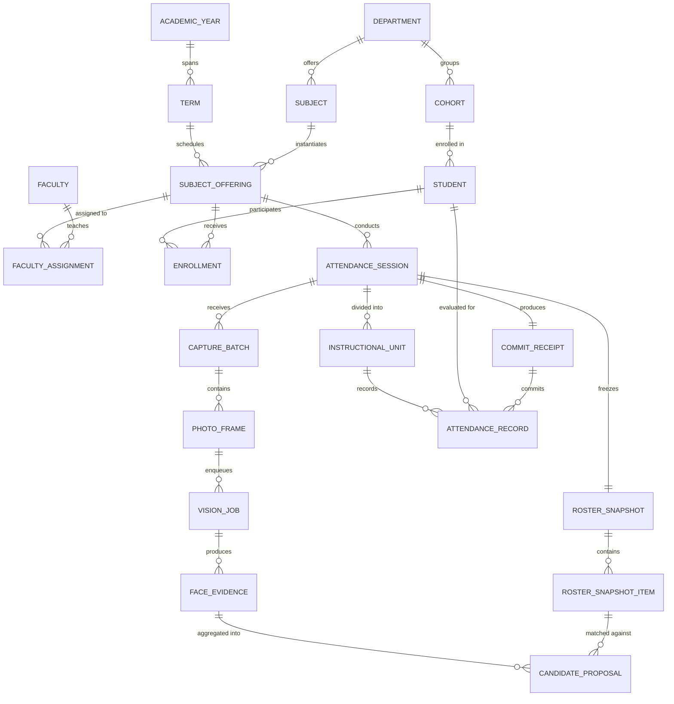
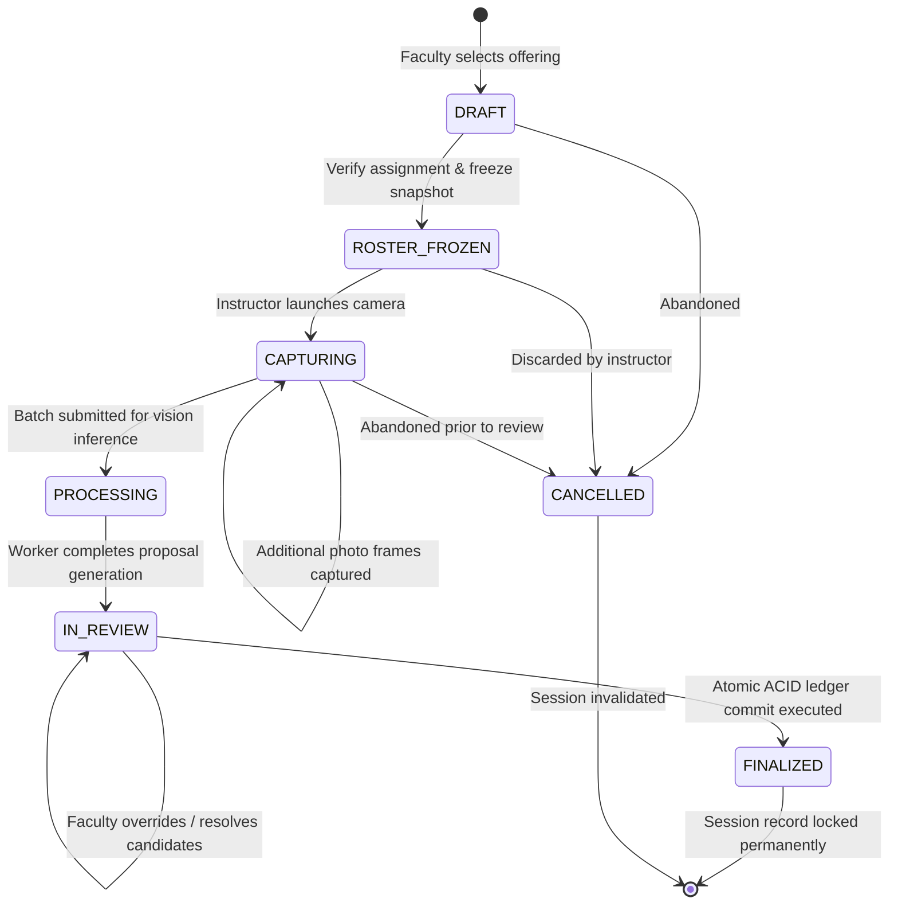
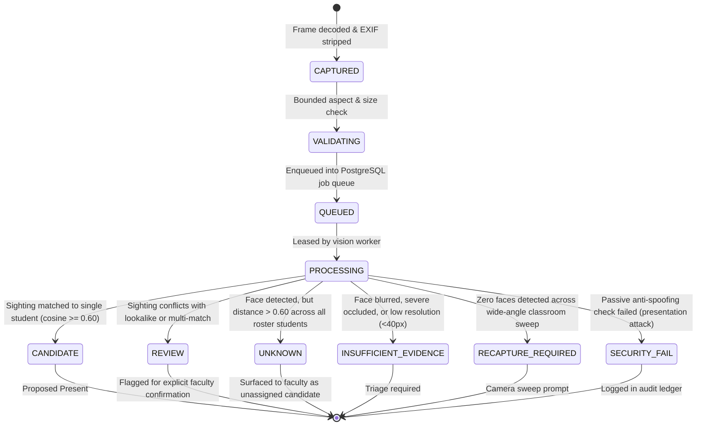
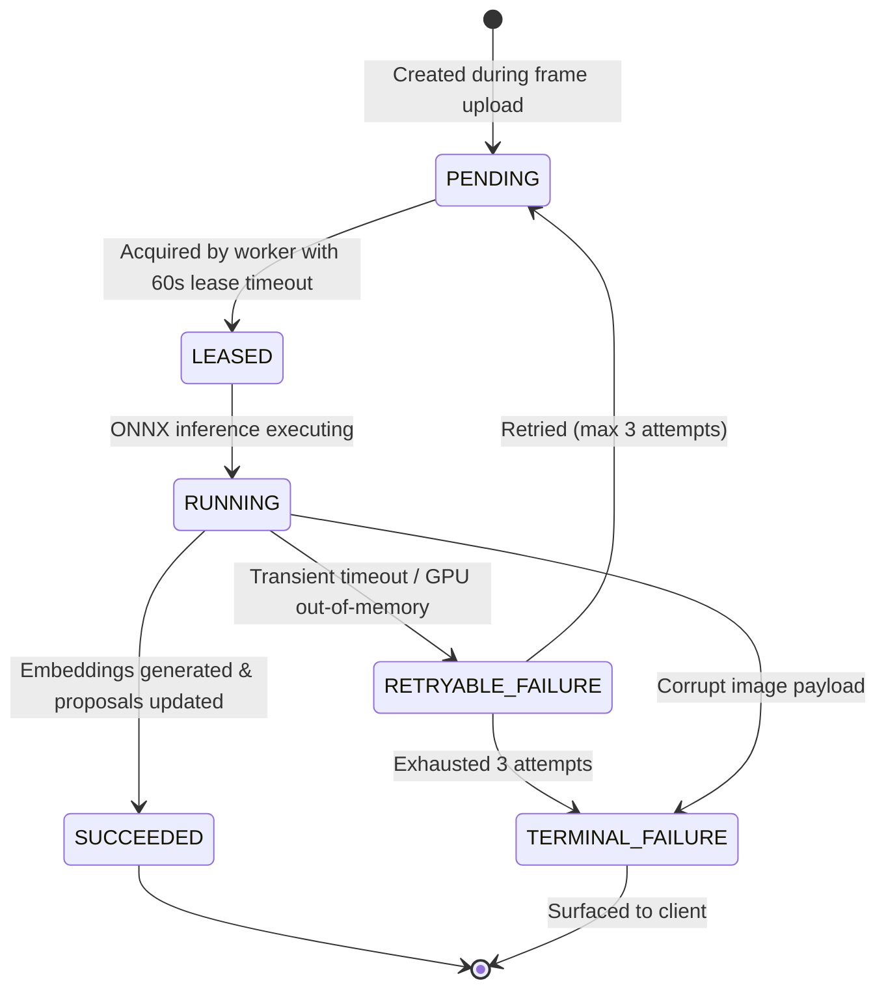

# Data Model & State Machine Specifications

The FRS V7.1 K² persistence tier is built on PostgreSQL 16 using strict relational normalization, immutable historical tables, and transactional locking to preserve academic integrity.

---

## Entity-Relationship Diagram



---

## Table Categorization Matrix (27 Tables)

The schema generated in baseline migration `3a42e90c6daf` is partitioned into seven functional domains:

| Domain | Core Tables | Responsibility |
| :--- | :--- | :--- |
| **Academic Hierarchy** | `departments`, `cohorts`, `academic_years`, `terms`, `subjects` | Defines college structure, academic semesters, and course syllabus. |
| **Offerings & Teaching** | `subject_offerings`, `authorized_class_groups`, `class_group_members`, `faculties`, `faculty_assignments` | Maps which instructors teach which sections or merged joint class groups. |
| **Student Roster** | `students`, `enrollments` | Authoritative student admissions, term registration, and enrollment status (`ACTIVE`, `INACTIVE`, `DROPPED`, `SUSPENDED`). |
| **Session Lifecycle** | `attendance_sessions`, `roster_snapshots`, `roster_snapshot_items`, `instructional_units` | Manages active classroom sessions, freezes student rosters, and tracks 1 to 4 units. |
| **Photo Ingress** | `capture_batches`, `photo_frames` | Stores metadata, SHA-256 digests, dimensions, and timestamps of classroom sweeps. |
| **Worker Queue & Evidence** | `vision_jobs`, `detected_faces`, `face_embeddings`, `candidate_proposals` | Manages asynchronous background processing, bounding boxes, 512-d embeddings, and match scores. |
| **Final Ledger & Audit** | `commit_receipts`, `attendance_records`, `attendance_overrides`, `audit_ledger_events` | Immutable, append-only attendance records, tamper-evident hash receipts, and administrative audit logs. |

---

## State Machine Lifecycles

### 1. Attendance Session State (`SessionState`)

A session represents an instructor's classroom lecture. Transitions are strictly forward-only:



### 2. Candidate Evidence State (`EvidenceState`)

Classroom detections transition through distinct evidence states based on recognition confidence and image quality:



### 3. Background Job Queue State (`JobState`)



---

## Atomic Ledger Commit Guarantees

When the faculty instructor clicks **"Sign & Finalize Attendance"**, the backend executes an atomic ACID transaction in `CommitService`:

1. **Session State Gate:** Verifies `session.state == SessionState.IN_REVIEW`.
2. **Faculty Authorization:** Verifies `session.faculty_id == current_user.faculty_id`.
3. **Idempotency Verification:** Checks `idempotency_key` against `commit_receipts`. If key already exists for this session, the existing receipt is returned immediately without double-writing.
4. **Instructional Unit Records:** Inserts `AttendanceRecord` rows for each enrolled student across all conducted unit indices ($1 \le \text{units} \le 4$).
5. **Cryptographic Receipt Hash:**
```math
H_{\mathrm{receipt}} = \operatorname{SHA-256}(\mathrm{id}_{\mathrm{session}} \parallel \mathrm{id}_{\mathrm{faculty}} \parallel t_{\mathrm{commit}} \parallel N_{\mathrm{present}} \parallel N_{\mathrm{absent}})
```
6. **Immutable Closure:** Updates `session.state = SessionState.FINALIZED`.
7. **Audit Ledger Logging:** Appends an immutable audit event (`ATTENDANCE_COMMITTED`) referencing the `receipt_hash`.

