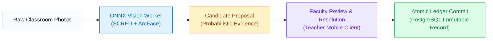

# FRS V7.1 K² System Documentation

Welcome to the official technical documentation and architecture wiki for the **Facial Recognition System (FRS) V7.1 K²**, designed for institutional deployment at **Kakatiya University College of Engineering & Technology (KUCET)**.

FRS V7.1 K² is an enterprise-grade classroom attendance proposal system. It replaces single-face biometric punch kiosks and legacy attendance registers with a multi-face classroom sweep workflow that preserves strict academic governance and faculty autonomy.

---

## Core System Philosophy

Unlike commercial black-box attendance software that automatically modifies attendance databases based on opaque recognition scores, FRS V7.1 enforces the **Human-in-the-Loop Proposal Principle**:

1. **Evidence Producer, Not Decision Maker:** The computer vision pipeline acts strictly as an evidence generator. It aggregates sightings, computes cosine similarity metrics, and highlights ambiguities. It cannot unilaterally commit attendance.
2. **Faculty-Governed Commit:** Only the assigned instructor who conducted the academic session can review the proposal, override candidate statuses, resolve unassigned sightings, and execute the final atomic ledger commit.
3. **Immutable Roster Freezing:** Eligibility is evaluated at the start of each session against active semester enrollments and frozen as an immutable roster snapshot. Downstream roster mutations never alter session history.
4. **Denominator Invariant:** Attendance percentages are strictly calculated per student per conducted instructional unit ($1 \le \text{units} \le 4$). Incomplete or unconducted units never skew student records. If zero units are conducted, the attendance percentage evaluates strictly to `N/A`.

---

## Documentation Index

The wiki is organized into seven specialized reference manuals:

| Section | Scope |
| :--- | :--- |
| **[System Architecture](System-Architecture)** | Multi-tier topology, microservices, container boundaries, and network isolation. |
| **[Data Model & State Machines](Data-Model-and-State-Machine)** | Complete 27-table relational schema, entity-relationship diagrams, and state transitions. |
| **[Computer Vision Pipeline](Computer-Vision-Pipeline)** | SCRFD detection, ArcFace 512-d embeddings, open-set rejection threshold ($\tau = 0.60$), and lookalike conflict routing. |
| **[REST API Reference](API-Reference)** | OpenAPI 3.1 endpoint dictionary, envelope specifications, error codes, and DTO contracts. |
| **[Security, Privacy & Governance](Security-Privacy-and-Governance)** | On-premise biometric boundaries, irreversible feature representations, client SHA-256 hashing, and audit trails. |
| **[Operations & Deployment](Operations-and-Deployment)** | Docker Compose deployment, multi-stage Dockerfiles, Alembic database migrations, and CI/CD pipelines. |
| **[Roadmap & Project Status](Roadmap-and-Project-Status)** | Verification matrix, current release baseline, operational constraints, and development roadmap. |

---

## Project Status At A Glance

* **Current Architecture Version:** V7.1 Canonical
* **FastAPI Control Plane:** Operational (52 automated unit, security, and persistence tests passing + 1 PG socket probe skip)
* **Playwright Browser E2E:** Operational (11/11 Admin Console routes verified against live Next.js compilation)
* **Alembic Database Migrations:** Baseline revision `3a42e90c6daf` active across 27 tables with fail-closed production URL validation and connection pooling (`pool_pre_ping=True`, `pool_recycle=1800`)
* **Ingress Guardrails:** Enforced (15MB bounded `Content-Length` [413], executable media type filtering [415], sliding-window rate limiting)
* **Teacher Mobile Client:** Implemented with Flutter 3.27.x (Material 3 Swiss Modernism theme, offline-resilient Riverpod state machine, durable 500-entry `OfflineSyncJournal`, `PermissionManager` lifecycle)
* **Admin Web Console:** Implemented with Next.js 15.5.28 App Router (12 prerendered routes, cross-tab session broadcasting, crawler exclusion in `public/robots.txt`)
* **Mathematical Invariants:** 5/5 verification suites passing with 100% invariant fidelity
* **Containerization:** Multi-stage Dockerfiles for backend API, vision worker, and Next.js console validated.

