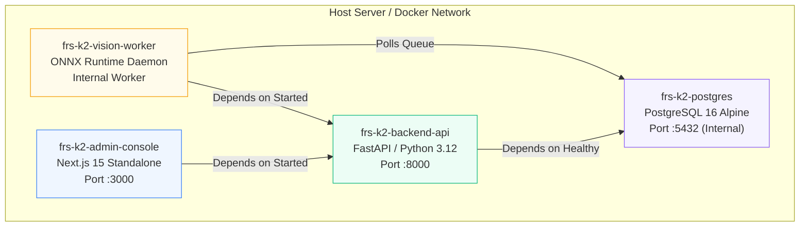

# Operations, Infrastructure & Deployment

FRS V7.1 K² provides containerized configurations for both single-node on-premise servers and multi-node clustered institutional environments.

---

## Container Stack Topology



---

## Local Single-Node Quickstart

### 1. Clone Repository & Prepare Environment
```bash
git clone https://github.com/KatkamKoushik/K-Squared-Face-Recognition-Attendance-System.git
cd frs-v7-1-k2

# Copy baseline configuration
cp .env.example .env
```

### 2. Launch Container Stack via Docker Compose
```bash
docker compose up -d
```

This launches:
* `postgres:16-alpine`: PostgreSQL database on port `5432` with automatic health check.
* `backend-api`: FastAPI control plane on `http://localhost:8000`.
* `vision-worker`: Background ONNX inference worker polling for vision jobs.
* `admin-console`: Next.js admin portal on `http://localhost:3000`.

### 3. Verify Health & Schema Migrations
```bash
# Check running containers
docker compose ps

# Apply latest Alembic schema migrations
docker compose exec backend-api alembic upgrade head

# Probe control-plane readiness
curl -s http://localhost:8000/api/v1/health/readiness | jq .
```

---

## Multi-Stage Container Image Architecture

Each container uses minimal base images and non-root system users for security:

### 1. Backend API (`backend/Dockerfile`)
* **Base:** `python:3.12-slim`
* **Builder Stage:** Compiles system dependencies, wheels, and dev tools.
* **Runner Stage:** Strips build compilers, creates unprivileged user `appuser (uid 1000)`, runs Uvicorn ASGI server with `--host 0.0.0.0 --port 8000`.

### 2. Vision Worker (`backend/Dockerfile.worker`)
* **Base:** `python:3.12-slim` (or `nvidia/cuda:12.4.1-runtime-ubuntu22.04` for GPU nodes).
* **Entrypoint:** `python -m app.worker.worker` pulling `PENDING` queue items with exponential backoff.

### 3. Admin Console (`apps/admin_console/Dockerfile`)
* **Base:** `node:22-alpine`
* **Builder Stage:** Executes `npm ci` and compiles Next.js standalone output (`output: "standalone"`).
* **Runner Stage:** Copies standalone bundle, creates unprivileged user `nextjs (uid 1001)`, runs `node server.js` on port `3000`.

---

## Database Migration & Connection Pool Architecture

Database schemas are strictly versioned using Alembic with asynchronous engine routing (`backend/alembic/env.py`) and sync driver translation:

```bash
cd backend

# View migration history
alembic history --verbose

# Apply migrations to head (baseline: 3a42e90c6daf, 27 tables)
alembic upgrade head

# Generate offline SQL script for air-gapped DBA review
alembic upgrade head --sql > migration_plan.sql

# Generate a new auto-detected migration revision
alembic revision --autogenerate -m "describe_schema_change"

# Rollback one migration
alembic downgrade -1
```

### Production Connection Pool Settings
The PostgreSQL engine (`backend/app/core/database.py`) enforces strict connection lifecycle policies:
* **`pool_size = 10`**: Baseline persistent connection count per worker instance.
* **`max_overflow = 20`**: Burst connection headroom during high-traffic classroom sweep bursts.
* **`pool_pre_ping = True`**: Proactively verifies socket vitality before checkout, preventing `ConnectionResetError` drops.
* **`pool_recycle = 1800`**: Recycles connections after 30 minutes to prevent PostgreSQL server-side connection timeout drops.
* **Fail-Closed URL Validation**: Production startup strictly aborts if `DATABASE_URL` is unconfigured, defaults to SQLite, or points to dummy credentials (`validate_database_url`).
* **Safe Credential Masking**: Password strings are strictly redacted (`***`) in startup logs, exception traces, and telemetry endpoints (`mask_database_url`).

---

## Verification & Automated Testing Commands

```bash
# 1. Backend Pytest Suite (50 unit/security/persistence tests)
cd backend && python -m pytest tests/ -v -m "not playwright"

# 2. Playwright Browser E2E Automation (11 routes verified)
cd backend && python -m pytest tests/test_playwright_admin_console.py -v

# 3. Domain Invariant Acceptance Runner (5 suites, 100% fidelity)
cd backend && python verify_backend.py

# 4. Admin Console Typecheck & Standalone Compilation
cd apps/admin_console && npm run typecheck && npm run build

# 5. Teacher Mobile Static Analysis
dart analyze apps/teacher_mobile
```

---

## Environment Variables Reference

| Variable | Target Service | Default | Description |
| :--- | :--- | :--- | :--- |
| `DATABASE_URL` | `backend-api`, `worker` | `postgresql+asyncpg://...` | Asynchronous PostgreSQL connection string. |
| `SECRET_KEY` | `backend-api` | *Required in Prod* | Minimum 32-byte secret key for JWT session signing. |
| `ENVIRONMENT` | `backend-api`, `worker` | `development` | Runtime environment (`development`, `staging`, `production`). |
| `PORT` | `backend-api` | `8000` | Port for FastAPI control plane server. |
| `NEXT_PUBLIC_API_URL` | `admin-console` | `http://localhost:8000/api/v1` | URL of the FastAPI control plane accessed by web clients. |
| `NODE_ENV` | `admin-console` | `production` | Node.js production runtime flag. |
| `API_URL` | `teacher_mobile` | `http://10.0.2.2:8000/api/v1` | Backend endpoint compiled via `--dart-define=API_URL=...`. |
| `KEYSTORE_PATH` | `teacher_mobile` | *Optional* | Android production release signing keystore file path. |

