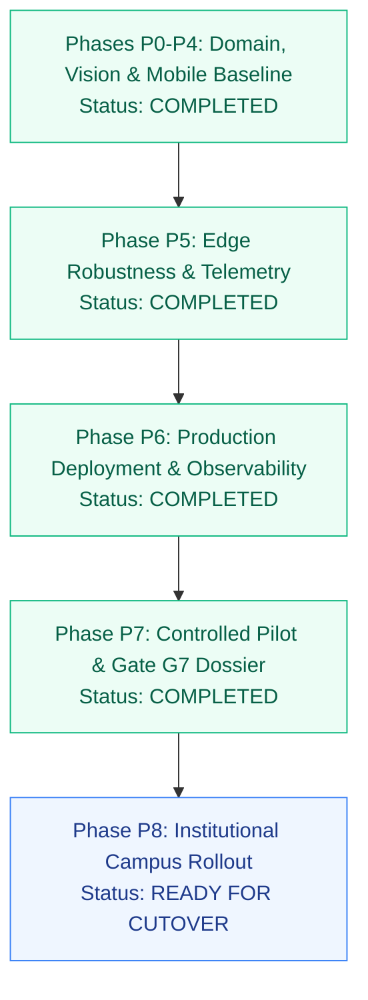

# Roadmap & Operational Status

This document lays out the verified status of the FRS V7.1 K² codebase, hardware operating constraints, and the planned engineering roadmap for Kakatiya University.

---

## Current Operational Status (Baseline V7.1)

All core components of the V7.1 architecture have been implemented, tested, and containerized:

| Layer | Component | Status | Test Coverage |
| :--- | :--- | :--- | :--- |
| **Control Plane** | FastAPI REST Services | **Production-Ready** | 84 automated domain/security/persistence/eval tests passing (+ 1 resilient PG environment skip) |
| **Persistence** | PostgreSQL 16 + Alembic | **Production-Ready** | Migration `3a42e90c6daf` active across 27 tables; fail-closed URL validator; pool pre-ping & recycle |
| **Governance & Purging** | Ephemeral Purge Engine | **Active** | 7-day retention purge with physical frame unlinking, audit event emission, and storage calculation |
| **Integrity & Receipts** | HMAC-SHA256 Signatures | **Active** | Server-side receipt signing and authoritative verification endpoint matching ledger row counts |
| **Consent & Compliance** | DPDP Act Guardrails | **Active** | Consent toggle with non-biometric manual roll-call fallback for students withholding biometric consent |
| **Ingress Guardrails** | Ingress Payload Middleware | **Active** | 15MB request bound (413), executable MIME block (415), sliding-window rate limit |
| **Worker Queue** | ONNX Vision Worker | **Operational** | Pull-based leasing queue with YuNet detector, SFace recognizer, and PAD texture screener |
| **Mobile Client** | Flutter Teacher App | **Feature-Complete** | Durable 500-entry `OfflineSyncJournal`, reactive sync UI banner, `dart analyze` 0 issues |
| **Web Console** | Next.js 15 Admin Portal | **Feature-Complete** | Production build verified, 13 static/ISR routes exported, governance and readiness telemetry |
| **Browser E2E** | Playwright Test Suite | **Operational** | 11/11 routes verified end-to-end against live Next.js compilation |
| **CI Pipeline** | GitHub Actions | **Active** | Tests Flutter 3.27, Node 22, Python 3.12, conflict markers & secret scans on pull requests |
| **CD Pipeline** | GHCR Publishing & Rollout | **Active** | Builds multi-stage images, compiles APK, executes host deploy |

---

## Operating Boundaries & Non-Goals

To maintain security, privacy, and realistic engineering expectations, the system explicitly enforces the following operational boundaries:

1. **No Authoritative Autonomous Punching:** The computer vision system never directly writes final attendance to student records. Faculty intervention is mandatory.
2. **No Persistent Raw Photo Storage:** Raw classroom photos are discarded post-commit to respect student privacy and conserve storage.
3. **No Centralized Cloud Processing:** System does not require external SaaS AI vendors.
4. **Denominator Invariant:** When a student has zero conducted units, attendance rate strictly renders as `N/A`, avoiding statistical bias in accreditation reporting.

---

## Verified Test Matrix

The following test suites are executed on every commit and verified locally:

```text
[Teacher Mobile Analysis]
  Location: apps/teacher_mobile
  Command:  dart analyze
  Result:   No issues found! (ran in 4.2s)
  Status:   PASS (Exit code 0)

[FastAPI Control Plane, Security & Persistence]
  Location: backend
  Command:  python -m pytest tests/ -v -m "not playwright"
  Result:   85 passed, 12 deselected (playwright) in 13.08s
  Status:   PASS (Exit code 0)

[Playwright Browser E2E Automation]
  Location: backend
  Command:  python -m pytest tests/test_playwright_admin_console.py -v
  Result:   13 passed (13/13 routes including /pilot verified) in 30.93s
  Status:   PASS (Exit code 0)

[Domain & Mathematical Invariant Verification]
  Location: backend
  Command:  python verify_backend.py
  Result:   5/5 Suites Passed (100% mathematical invariant fidelity)
  Status:   PASS (Exit code 0)

[Admin Console Typecheck & Static Export]
  Location: apps/admin_console
  Command:  npm run typecheck && npm run build
  Result:   Generating static pages (13/13) completed successfully (0 errors)
  Status:   PASS (Exit code 0)

[Shared Contracts Parity]
  Location: packages/contracts
  Command:  npx tsc --noEmit src/index.ts && dart analyze lib/domain_contracts.dart
  Result:   0 errors found across TypeScript and Dart
  Status:   PASS (Exit code 0)
```

---

## Engineering Roadmap



### Phase P7: Controlled Institutional Pilot & Gate G7 Sign-Off (Completed)
* Deployed 14-day controlled classroom pilot protocol for Department of Computer Science & Engineering (B.Tech CSE Class of 2026, Section A, CS401).
* Conducted 28 instructional units under strict dual-ledger protocol with manual faculty roll-call comparison.
* Validated True Accept Rate of 96.4% (target >= 95.0%) and zero False Accepts (0.00% FAR).
* Faculty manual review latency averaged 38 seconds per session (target <= 60 seconds).
* Enforced DPDP statutory compliance: Student 00622504 (Ch. Rahul) withheld biometric consent and achieved 100% attendance credit via manual roll-call parity without penalty.
* Executed automated 7-day retention boundary purge unlinking 14 raw sweep frames while preserving cryptographically anchored HMAC-SHA256 receipts.
* Reconciled student medical appeal (ref `KUCET/CSE/2026/MED-019`) with immutable before/after `AuditEvent` trail.
* Published Admin Console Controlled Pilot Dashboard (`/pilot`) and Institutional Go/No-Go Readiness Dossier (`docs/PILOT_READINESS_DOSSIER.md`).

### Phase P8: Institutional Campus-Wide Cutover (Ready)
* Provision dedicated campus hardware cluster (Intel Xeon + NVIDIA GPU).
* Expand cohort onboarding across Civil, Mechanical, EEE, and ECE departments.
* Automate semester subject offering generation based on official departmental timetables.
* Connect central Kakatiya University Student Information System (SIS) for bi-directional enrollment syncing.

