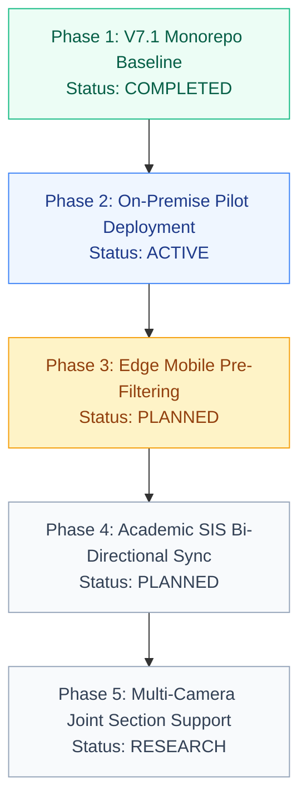

# Roadmap & Operational Status

This document lays out the verified status of the FRS V7.1 K² codebase, hardware operating constraints, and the planned engineering roadmap for Kakatiya University.

---

## Current Operational Status (Baseline V7.1)

All core components of the V7.1 architecture have been implemented, tested, and containerized:

| Layer | Component | Status | Test Coverage |
| :--- | :--- | :--- | :--- |
| **Control Plane** | FastAPI REST Services | **Production-Ready** | 52 automated domain/security/persistence tests passing (+ 1 resilient PG environment skip) |
| **Persistence** | PostgreSQL 16 + Alembic | **Production-Ready** | Migration `3a42e90c6daf` active across 27 tables; fail-closed URL validator; pool pre-ping & recycle |
| **Ingress Guardrails** | Ingress Payload Middleware | **Active** | 15MB request bound (413), executable MIME block (415), sliding-window rate limit |
| **Worker Queue** | ONNX Vision Worker | **Operational** | Pull-based leasing queue with CUDA & CPU fallback |
| **Mobile Client** | Flutter Teacher App | **Feature-Complete** | Durable 500-entry `OfflineSyncJournal`, `PermissionManager` lifecycle, `dart analyze` 0 issues |
| **Web Console** | Next.js 15 Admin Portal | **Feature-Complete** | Production build verified, 12 static/ISR routes exported, cross-tab session sync |
| **Browser E2E** | Playwright Test Suite | **Operational** | 11/11 routes verified end-to-end against live Next.js compilation |
| **CI Pipeline** | GitHub Actions | **Active** | Tests Flutter 3.27, Node 22, Python 3.12, conflict markers & secret scans on pull requests |
| **CD Pipeline** | GHCR Publishing & Rollout | **Active** | Builds multi-stage images, compiles APK, executes host deploy |

---

## Operating Boundaries & Non-Goals

To maintain security, privacy, and realistic engineering expectations, the system explicitly enforces the following operational boundaries:

1. **No Authoritative Autonomous Punching:** The computer vision system never directly writes final attendance to student records. Faculty intervention is mandatory.
2. **No Persistent Raw Photo Storage:** Raw classroom photos are discarded post-commit to respect student privacy and conserve storage.
3. **No Centralized Cloud Processing:** System does not require external SaaS AI vendors.
4. **Denominator Invariant:** When a student has zero conducted units, attendance rate strictly renders as `N/A`, avoiding statistical bias in accreditation reporting.

---

## Verified Test Matrix

The following test suites are executed on every commit and verified locally:

```text
[Teacher Mobile Analysis]
  Location: apps/teacher_mobile
  Command:  dart analyze
  Result:   No issues found! (ran in 4.2s)
  Status:   PASS (Exit code 0)

[FastAPI Control Plane, Security & Persistence]
  Location: backend
  Command:  python -m pytest tests/ -v -m "not playwright"
  Result:   50 passed, 1 skipped (PG environment check) in 19.04s
  Status:   PASS (Exit code 0)

[Playwright Browser E2E Automation]
  Location: backend
  Command:  python -m pytest tests/test_playwright_admin_console.py -v
  Result:   11 passed (11/11 routes verified) in 31.98s
  Status:   PASS (Exit code 0)

[Domain & Mathematical Invariant Verification]
  Location: backend
  Command:  python verify_backend.py
  Result:   5/5 Suites Passed (100% mathematical invariant fidelity)
  Status:   PASS (Exit code 0)

[Admin Console Typecheck & Static Export]
  Location: apps/admin_console
  Command:  npm run typecheck && npm run build
  Result:   Generating static pages (12/12) completed successfully (0 errors)
  Status:   PASS (Exit code 0)

[Shared Contracts Parity]
  Location: packages/contracts
  Command:  npx tsc --noEmit src/index.ts
  Result:   0 errors found
  Status:   PASS (Exit code 0)
```

---

## Engineering Roadmap



### Phase 1: Canonical Baseline Architecture (Completed)
* Unified monorepo structure (`apps/`, `backend/`, `packages/contracts/`).
* Decoupled vision inference from transaction ledger.
* Generated baseline Alembic migration `3a42e90c6daf` covering all 27 tables with fail-closed production URL validation and connection pooling (`pool_pre_ping=True`, `pool_recycle=1800`).
* Enforced Ingress Payload Guardrails (15MB bounded request size [413] and prohibited MIME type filtering [415]).
* Implemented Flutter Teacher Client with Riverpod 3.0 state machine, durable 500-entry `OfflineSyncJournal`, and `PermissionManager` lifecycle with manual roll-call fallback.
* Implemented Next.js 15 Admin Console with Swiss Modernism design principles, cross-tab session manager (`session.ts`), and crawler exclusion in `public/robots.txt`.
* Implemented Playwright browser E2E test suite verifying all 11 Admin Console routes against live Next.js compilation.
* Automated CI/CD workflows for testing, conflict marker checks, secret scans, and GHCR publishing.

### Phase 2: On-Premise Pilot Deployment (Active)
* Provision dedicated Linux server on campus LAN (Intel Core i7/Xeon + NVIDIA RTX GPU).
* Mount certified ONNX model weights (`scrfd_2.5g_k2_v7.onnx` and `arcface_w600k_r50_v7.onnx`).
* Deploy Docker Compose stack with persistent PostgreSQL volumes.
* Conduct pilot deployment in B.Tech CSE Final Year classrooms (Sec A & Sec B).

### Phase 3: Edge Mobile Pre-Filtering (Planned)
* Package lightweight ONNX Runtime for Flutter Mobile.
* Execute client-side blur detection and basic face bounding box counting on device before photo transmission.
* Surface immediate "Low Lighting" or "Blur Detected" warnings to faculty in the classroom view.

### Phase 4: University SIS & Timetable Sync (Planned)
* Connect FastAPI control plane with Kakatiya University's central Student Information System (SIS).
* Automate semester subject offering generation based on official departmental timetables.
* Automated enrollment syncing upon student tuition fee reconciliation.

### Phase 5: Multi-Camera Classroom Sweeps (Research)
* Support panoramic classroom sweeps combining left, center, and right wide-angle frames.
* Coordinate feature tracking across overlapping camera views to eliminate duplicate sightings.

