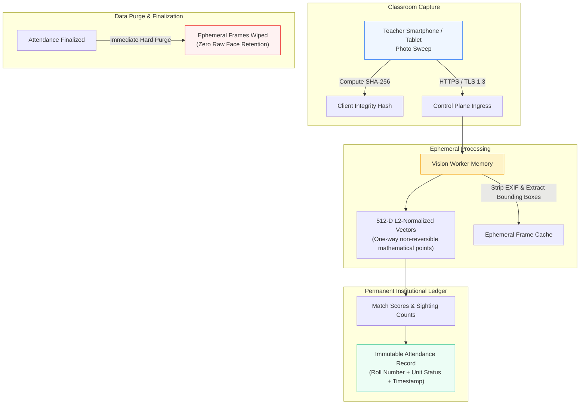

# Security, Privacy & Biometric Governance

FRS V7.1 K² is designed around strict privacy protections, regulatory compliance with educational data standards, and zero reliance on commercial third-party cloud APIs.

---

## Biometric Data Governance Principles

### 1. Zero Cloud Dependency (Institutional Sovereignty)
* **No External API Calls:** Biometric inference runs strictly on Kakatiya University's internal servers. Photographs and feature vectors are never transmitted to Google Cloud, Amazon Web Services, Microsoft Azure, OpenAI, or any third-party SaaS provider.
* **Air-Gap Capable:** The entire stack (FastAPI control plane, PostgreSQL database, ONNX vision worker, and Next.js console) can operate on an isolated campus intranet without public internet access.

### 2. Irreversible Mathematical Representations
* The ArcFace neural network maps facial images into 512-dimensional floating-point vectors on a unit hypersphere ($\mathbb{S}^{511}$).
* **Non-Invertibility:** It is mathematically impossible to reconstruct a student's original photograph, facial texture, or identifiable biometric image from a 512-dimensional embedding vector.

### 3. Ephemeral Frame Retention & Automated Purge
* Raw classroom photograph sweeps are stored in temporary, bounded volume storage strictly during active session inference.
* Following faculty commit or session closure, raw image frames are scheduled for immediate cryptographic wiping. The system permanently retains only the structured attendance ledger (Roll Number, Course Code, Unit Index, Date, Status, Receipt Hash).

### 4. Client-Side Cryptographic Hashing
* Before any classroom image is uploaded from the teacher's mobile device, the Flutter client computes a `SHA-256` checksum of the raw bytes.
* The backend independently computes the `SHA-256` digest upon ingress. If the hashes mismatch, the frame is rejected immediately, preventing in-transit corruption or tampering.

### 5. Biometric Redaction In Audits & Telemetry
* As demonstrated on the Admin Console [Audit Logs](file:///d:/k^2/apps/admin_console/app/audit/logs/page.tsx), facial crops, bounding box coordinates, and raw embedding arrays are strictly redacted from operational logs, administrative views, and audit tables.

### 6. Ingress Payload Guardrails & Multi-Session Isolation
* **Pre-Parsing Payload Boundary:** Inbound HTTP requests are validated prior to body buffering. Payloads exceeding 15MB are rejected with `413 Payload Too Large`. Executable binaries, scripts, and suspicious MIME types (`application/x-sh`, `application/x-msdownload`, `.exe`, `.bat`) are blocked with `415 Unsupported Media Type`.
* **Mobile Sync Journal Context Isolation:** The Teacher Mobile client buffers pending offline sync items in a secure journal partitioned strictly by faculty account ID (`OfflineSyncJournal`). Logging out triggers a full purge to prevent account cross-contamination.
* **Admin Console Session Purge & Crawler Exclusion:** The Admin Web Console uses cross-tab `BroadcastChannel` synchronization (`session.ts`). On sign-out or session timeout, `localStorage` and `sessionStorage` caches are wiped instantly. `public/robots.txt` enforces complete crawler exclusion (`User-agent: *`, `Disallow: /`) to prevent indexing of student registries or audit records.

---

## Role-Based Access Control (RBAC)

The FastAPI control plane enforces strict role boundaries:

| Role | Scope | Permitted Capabilities | Prohibited Operations |
| :--- | :--- | :--- | :--- |
| **`FACULTY`** | Classroom Sessions | Create session, capture photo sweeps, inspect candidate proposals, override proposal states, sign commit receipts. | Cannot alter academic course catalogs, cohort structures, or student rosters. |
| **`ADMIN`** | Institutional Governance | Register students, configure departments, assign faculty, view audit ledger, inspect attendance analytics. | Cannot initiate classroom sessions or sign faculty attendance receipts. |
| **`OPERATOR`** | System Maintenance | Inspect system readiness probes, restart vision workers, view queue lease latencies. | Cannot view student identity records or attendance percentages. |
| **`WORKER`** | Asynchronous Processing | Lease `PENDING` vision jobs, read photo bytes, write detected bounding boxes and embeddings. | Cannot commit final attendance records or alter session state to `FINALIZED`. |

---

## Immutable Audit Trail

Every state-altering event is recorded in the `audit_ledger_events` table with:
* `id`: Unique event identifier (e.g. `EVT-90124`).
* `timestamp`: High-precision UTC timestamp.
* `actor_id`: User identifier of the faculty or administrator.
* `actor_role`: Institutional role at the time of execution.
* `action`: Action enum (`SESSION_CREATED`, `ROSTER_FROZEN`, `FRAME_UPLOADED`, `PROPOSAL_REVIEWED`, `ATTENDANCE_COMMITTED`, `POST_COMMIT_OVERRIDE`).
* `resource_id`: Target entity identifier (session, offering, student).
* `reason`: Mandatory text justification for administrative overrides or manual corrections.
* `transaction_hash`: SHA-256 cryptographic signature anchoring the ledger record.

