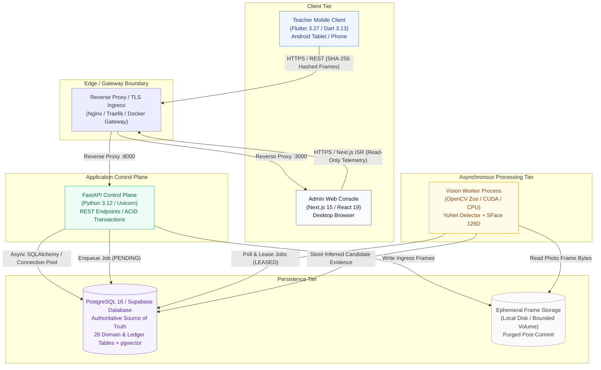
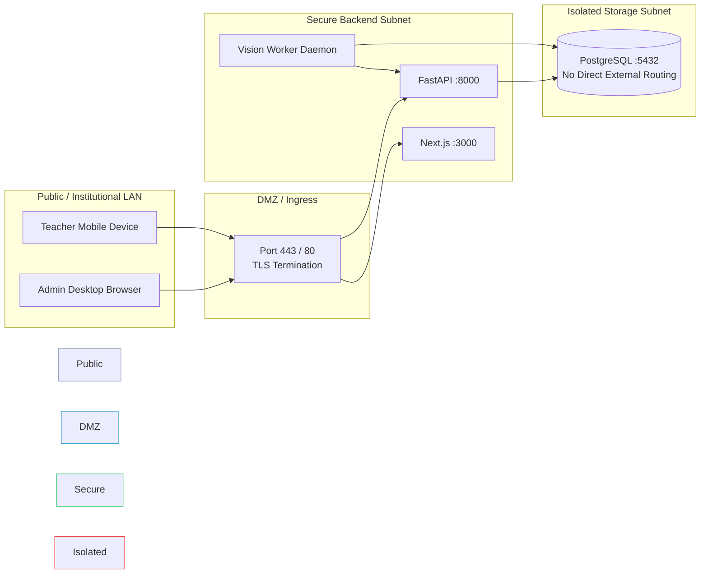

# System Architecture & Component Topology

FRS V7.1 K² implements a decoupled, asynchronous, four-tier architecture designed to run on institutional on-premise hardware without external cloud dependencies.

---

## Architectural Topology

---

## Component Inventory

### 1. Teacher Mobile Client (`apps/teacher_mobile`)
* **Technology Stack:** Flutter 3.27.x, Dart 3.13.x, Riverpod 3.0 Notifier, targeting Android 16 (API 36) with Gradle 8.14 and AGP 8.11.1.
* **Role:** Primary interaction touchpoint for faculty. Used inside the classroom to:
  * Authenticate faculty credentials (primary coordinator: Dr. M. Soujanya, IT Academic Coordinator, `soujanyavedh@gmail.com`).
  * Connect to flexible control plane backends via instant preset switching (`Ngrok Tunnel`, `Wi-Fi LAN` `192.168.0.2`, `ADB Reverse` `127.0.0.1:8000`, `Emulator`).
  * Select assigned subject offering or joint class group with real-time student enrollment tallies.
  * Define planned and conducted unit counts ($1 \le \text{units} \le 4$).
  * Capture multi-frame sweeps (wide-angle photos of student rows).
  * Calculate SHA-256 digests client-side before transmission.
  * Inspect probability candidates, resolve unknown faces or lookalike ambiguities.
  * Commit attendance decisions atomically to receive an immutable transaction receipt.
* **Offline Resilience & Data Integrity:**
  * **`OfflineSyncJournal`**: Durable, bounded (500 entries) action journal with faculty account context isolation, jittered exponential backoff for background replay, and strict logout purge.
  * **`PermissionManager`**: Dynamic permission lifecycle tracking with resume cache-busting and seamless manual roll-call fallback when camera hardware or permissions are restricted.

### 2. Admin Web Console (`apps/admin_console`)
* **Technology Stack:** Next.js 15.5.28 (App Router), React 19, TypeScript, Tailwind CSS.
* **Role:** Administrative and institutional oversight portal used by academic deans, department heads, and system operators to:
  * Maintain student directories, cohorts, terms, and subject offerings.
  * Configure faculty teaching assignments and approved joint class groups.
  * Browse the immutable audit ledger with biometric crops redacted.
  * Monitor system health, database connection pool saturation, and ONNX model approvals.
  * Generate official institutional attendance registers with denominator guardrails ($0 \text{ conducted units} \rightarrow \text{N/A}$).
* **Security & Session Governance:**
  * **`session.ts`**: Cross-tab session state synchronization via `BroadcastChannel` with guaranteed wipe of `sessionStorage` and `localStorage` on logout or session expiration.
  * **Crawler Privacy Protection**: `public/robots.txt` disallows all web crawlers (`User-agent: *`, `Disallow: /`) to prevent indexing of student registries or audit records.

### 3. Shared Contracts Package (`packages/contracts`)
* **Role:** Single source-of-truth contract definitions maintaining parity across Python, TypeScript, and Dart.
* **Artifacts:**
  * Canonical OpenAPI 3.1 specification (`openapi.json`).
  * Typed TypeScript interfaces and enums (`src/domain_contracts.ts`).
  * Typed Dart DTOs and bidirectional wire extensions (`lib/domain_contracts.dart`).

### 4. FastAPI Control Plane (`backend/app`)
* **Technology Stack:** Python 3.12, FastAPI 0.141+, SQLAlchemy 2.0, Pydantic V2, Uvicorn.
* **Role:** Authoritative business logic gatekeeper and transaction orchestrator:
  * Enforces role-based authorization (ADMIN, FACULTY, OPERATOR, WORKER).
  * Validates faculty teaching assignments before session creation.
  * Enforces immutable roster snapshots during session initialization.
  * Executes atomic ACID ledger commits with replay idempotency (`idempotency_key`).
  * Computes institutional attendance analytics directly from committed unit records.
* **Ingress Guardrails & Resilience:**
  * **`payload_guardrail_middleware`**: Rejects requests exceeding 15MB with `413 Payload Too Large` and blocks prohibited executable MIME types (e.g. `.sh`, `.exe`) with `415 Unsupported Media Type` before body parsing.
  * **Rate Limiting & Security Headers**: Sliding-window rate limiter per client IP and OWASP security headers (`nosniff`, `DENY`, `strict-origin-when-cross-origin`, HSTS).
  * **PostgreSQL Engine & Pool Lifecycle**: Centralized SQLAlchemy 2.0 async engine with fail-closed production URL validation (`validate_database_url`), credential masking, `pool_pre_ping=True`, and `pool_recycle=1800` to prevent socket disconnects.
  * **Alembic Schema Versioning**: Baseline migration `3a42e90c6daf` encompassing all 27 domain, ledger, and queue tables.

### 5. Vision Worker (`backend/app/worker`)
* **Technology Stack:** Python 3.12, OpenCV 4.10+ / OpenCV Zoo ONNX, NumPy, Pillow.
* **Role:** Asynchronous background worker operating on a pull-based leasing queue:
  * Leases `PENDING` vision jobs from PostgreSQL with retryable lock timeouts.
  * Executes YuNet multi-scale face detection and 5-point landmark localization on ingested classroom frames.
  * Aligns facial landmarks and extracts 128-dimensional L2-normalized SFace embeddings on the unit hypersphere $\mathbb{S}^{127}$.
  * Compares query sighting embeddings against the session's frozen roster embeddings using cosine similarity.
  * Evaluates open-set rejection boundaries ($\tau = 0.363$, $\Delta s \ge 0.10$) and populates candidate proposal records.
  * Ensures zero face detection on non-face / random object imagery without hallucinating student identities.

---

## Network Isolation & Security Boundaries

1. **Database Isolation:** PostgreSQL is strictly bound to internal Docker bridge networks (`127.0.0.1` or container DNS). Port `5432` is never exposed to the public internet or campus Wi-Fi.
2. **Stateless Processing:** Neither the mobile client nor the admin console maintains persistent database connections; all communication transits authenticated REST interfaces.
3. **No Biometric Vector Egress:** Raw facial crops and 512-dimensional embedding vectors remain strictly inside the persistence tier and are redacted before entering client logs or web dashboards.
4. **Ingress Payload Boundaries:** Inbound requests enforce strict payload size bounds ($15\text{ MB}$) returning `413 Payload Too Large` and reject dangerous or executable MIME types (`application/x-sh`, `application/x-msdownload`, `.exe`, `.bat`) with `415 Unsupported Media Type` prior to body parsing.

